<p align="center">
  
</p>

<p align="center">
  <strong>A Rust-powered, device-local guitar and bass processor built around Raspberry Pi 5.</strong>
</p>

<p align="center">
  <em>Active development — the software, installation process and hardware support are still evolving.</em>
</p>

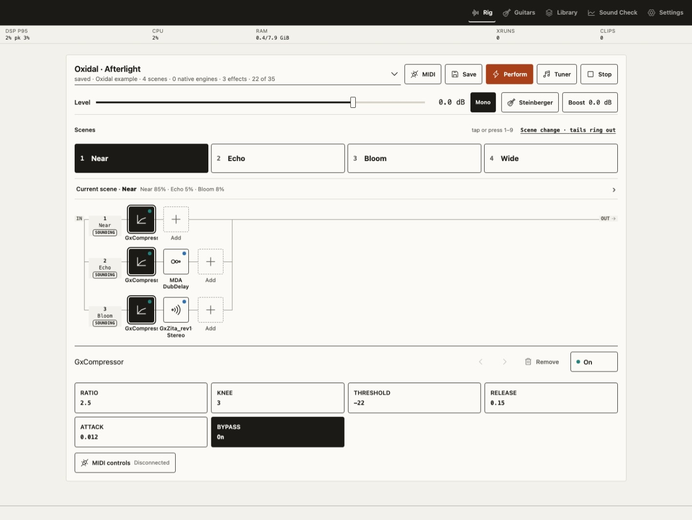

Oxidal uses Neural Amp Modeler (NAM) captures as its primary tone source for amp
heads, cabinets and complete captured rigs. TONE3000 preset compatibility and
supported LV2 effects turn those tones into playable rigs with prepared scenes. Its
Rust backend owns the control plane, library, device services and audio-engine
supervision. The browser is the controller; processing, presets and account data
stay on the device.

## Tone and effects

- **NAM first** — load licensed NAM captures for an amp head, cabinet or complete
  signal chain, with impulse responses available for cabinet and room processing.
- **TONE3000 preset compatibility** — import compatible `.t3kpreset` files and work
  with their native rig structure. Oxidal does not bundle TONE3000 presets or their
  associated captures.
- **Supported LV2 effects** — build around the core NAM tone with selected
  distortion, fuzz, compression, filtering, modulation, pitch, delay and reverb
  plugins. Curated support includes effects from Guitarix, Invada, MDA, SWH, x42,
  FOMP and Dragonfly, alongside Oxidal Hold and Oxidal Pitch. LV2 support is a
  qualified compatibility profile, not a claim that every LV2 plugin will work.

Upstream projects: [Neural Amp Modeler](https://www.neuralampmodeler.com/),
[TONE3000](https://www.tone3000.com/) and [LV2](https://lv2plug.in/).
See Oxidal's [native preset adapter](docs/native-tone3000.md) and
[LV2 compatibility notes](docs/lv2.md) for supported workflows.

## Playing live

- **Flexible rigs** — arrange native processors and supported LV2 effects in serial,
  parallel and scene-based signal paths.
- **Scenes and MIDI** — preload scenes and switch from the browser or a mapped
  MIDI controller. Supported layouts can retain delay and reverb trails.
- **Sound Check** — set up the audio interface, match levels and monitor live
  audio and processing health.

## Raspberry Pi appliance

Oxidal has a custom headless Linux image based on Raspberry Pi OS Lite. It sets
up the audio services, supported effect packs and a password-protected Wi-Fi
hotspot. Join the hotspot from a phone or tablet and open `https://oxidal.local`
using the generated device credentials and certificate setup. Local playback
works offline. You can also join an existing Wi-Fi network or use Ethernet.

Presets and device settings live on a separate data partition. Once you've
checked your audio setup, you can choose a saved session to load at boot. See the
[image build and setup guide](os/README.md#phone-access-and-first-sound).
The upstream base image comes from [Raspberry Pi OS](https://www.raspberrypi.com/software/operating-systems/).

## Repository scope

This repository contains the Oxidal software, browser interface, appliance image
recipes and documentation. The hardware controller is developed separately.

## Acknowledgments

Oxidal grew out of Richard Sentino's integration patches for
[PiPedal](https://github.com/rerdavies/pipedal) and the
[TONE3000 plugin](https://github.com/tone-3000/tone3000-plugin).
Thanks to both projects and their contributors. See Richard's
[archived PiPedal integration](https://github.com/rixrix/pipedal/pull/1) and the
[archived TONE3000 stage bridge](https://github.com/rixrix/tone3000-plugin/pull/1).

## Architecture

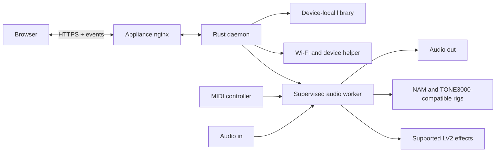

The control plane owns the API, library and device settings. A supervised worker is
the single owner of the audio interface. Read the
[architecture guide](docs/architecture.md) for process boundaries and contracts.

## Rust crates

| Crate                                       | What it does                                                                 |
| ------------------------------------------- | ---------------------------------------------------------------------------- |
| [`oxidal-api`](crates/oxidal-api)           | Runs the daemon, serves the web UI and API, and supervises audio workers.    |
| [`oxidal-audio`](crates/oxidal-audio)       | Discovers and probes Linux audio devices and provides ALSA streaming.        |
| [`oxidal-control`](crates/oxidal-control)   | Defines rig controls, MIDI mappings, and the control state machine.          |
| [`oxidal-debug`](crates/oxidal-debug)       | Runs maintenance commands in a separate service.                             |
| [`oxidal-device`](crates/oxidal-device)     | Handles Wi-Fi, hotspot, power, and effect-pack management on the appliance.  |
| [`oxidal-engine`](crates/oxidal-engine)     | Runs mixed rigs with native tones, LV2 effects, and preloaded scenes.        |
| [`oxidal-graph`](crates/oxidal-graph)       | Validates and prepares signal routing shared by the audio engines.           |
| [`oxidal-lv2`](crates/oxidal-lv2)           | Discovers and hosts supported LV2 plugins on Linux.                          |
| [`oxidal-nam`](crates/oxidal-nam)           | Implements NAM inference in Rust for supported model architectures.          |
| [`oxidal-presets`](crates/oxidal-presets)   | Validates and stores presets, rig bundles, and local model assets.           |
| [`oxidal-tone3000`](crates/oxidal-tone3000) | Wraps the native TONE3000 engine for compatible preset editing and playback. |

## Current status

The working appliance runs live NAM-based audio, supports compatible TONE3000 preset
import, prepared scene recall and selected LV2 effects, and exposes guitar, MIDI,
audio and health workflows in the browser. Automated checks cover the Rust services,
web application, contracts, packaging and isolated audio workers.

Oxidal targets x86-64 Linux and Raspberry Pi ARM64. Physical-interface coverage,
real-time qualification, recovery and installation across supported hardware remain
in progress. Use a fresh SD card for Raspberry Pi experiments.

Oxidal does not distribute TONE3000 presets, NAM captures, impulse responses or
provider downloads. Factory images contain Oxidal-authored effects-only examples;
players supply assets they are licensed to use. The tiny `.t3kpreset` files in the
test suite are project-authored parser fixtures with no model weights or playable
tone.

## Development

Use Node 22.21.0, pnpm 10.32.1 and Rust 1.95.0.

```sh
rustup toolchain install 1.95.0 --profile minimal --component clippy,rustfmt
npm install --global pnpm@10.32.1
pnpm bootstrap
pnpm hooks:install
pnpm dev
```

Open <http://127.0.0.1:5173>. No Raspberry Pi is required for browser and control
plane development.

```sh
pnpm check
pnpm guardrails:prove
pnpm contract:check
pnpm release:dry-run
```

Start with the [documentation index](docs/README.md),
[development guide](docs/development.md), [web interface](apps/web/README.md) or
[appliance image guide](os/README.md).

## Screenshot gallery

Click a screenshot to see it at full size. The browser views were captured on a
running appliance. The Wi-Fi network name is redacted.

### Playing and monitoring

| Perform                                                                                                        | Effect controls                                                                                                          |
| -------------------------------------------------------------------------------------------------------------- | ------------------------------------------------------------------------------------------------------------------------ |
| [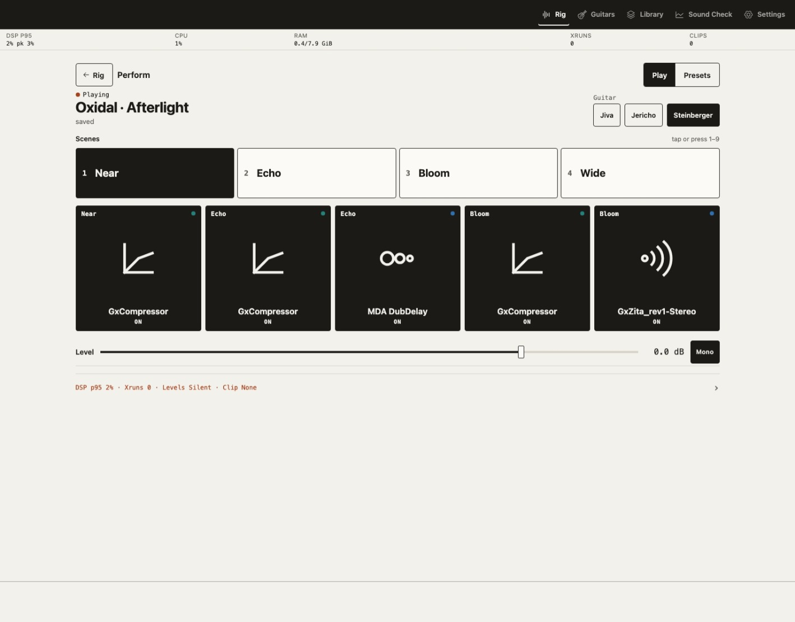](docs/assets/screenshots/perform-afterlight.jpeg) | [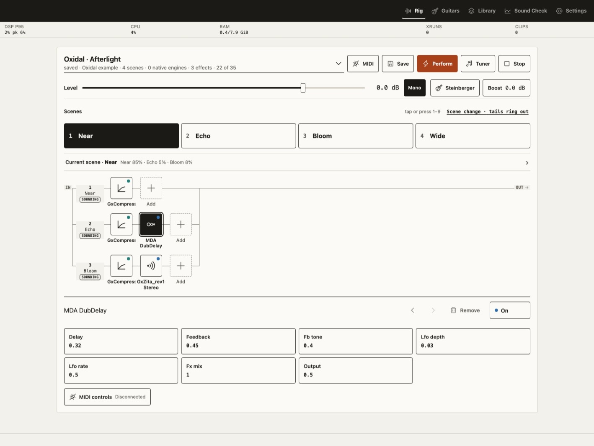](docs/assets/screenshots/rig-effect-controls.jpeg) |

| Sound Check overview                                                                                          | Live diagnostics                                                                                                                  |
| ------------------------------------------------------------------------------------------------------------- | --------------------------------------------------------------------------------------------------------------------------------- |
| [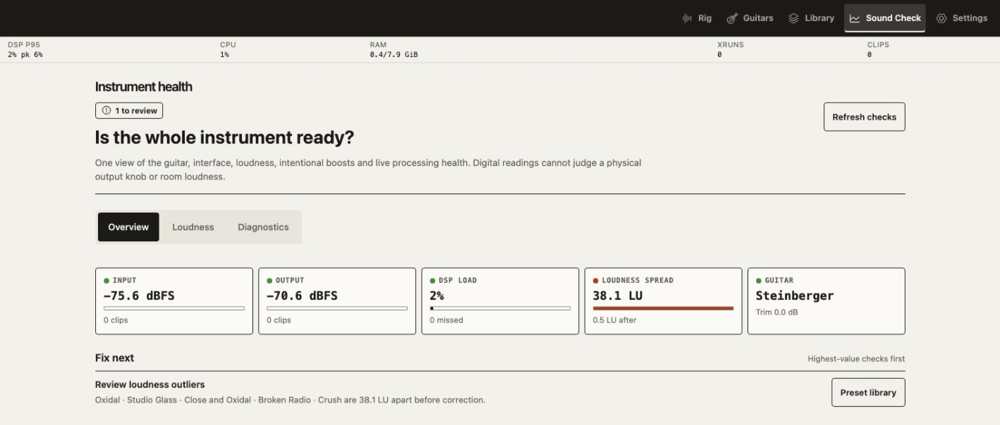](docs/assets/screenshots/sound-check.jpeg) | [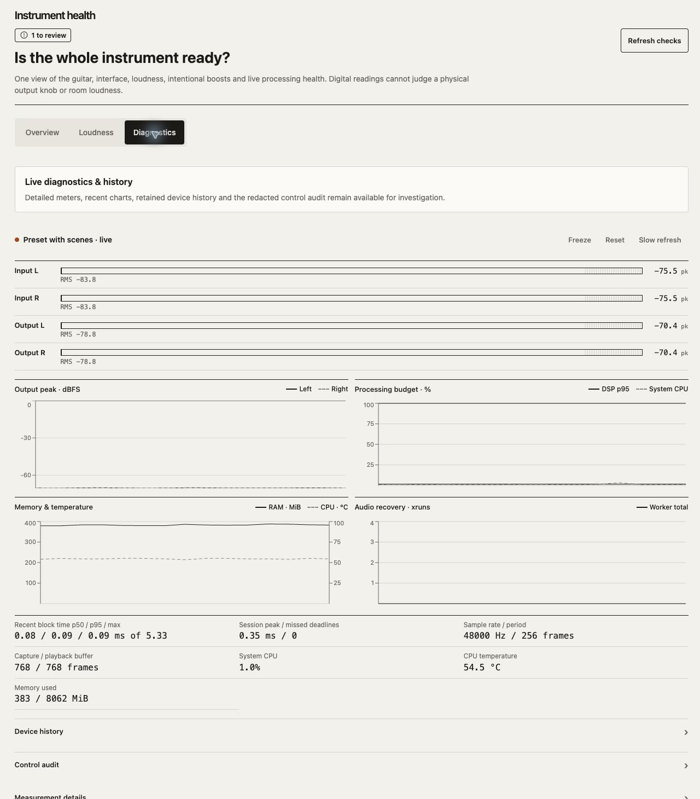](docs/assets/screenshots/sound-check-diagnostics.jpeg) |

### Settings

| Audio setup                                                                                                | Running engine                                                                                                |
| ---------------------------------------------------------------------------------------------------------- | ------------------------------------------------------------------------------------------------------------- |
| [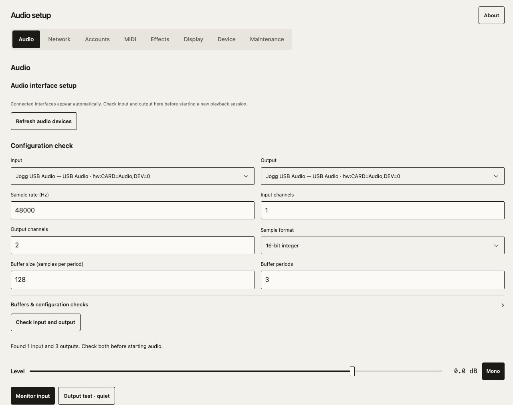](docs/assets/screenshots/settings-audio.jpeg) | [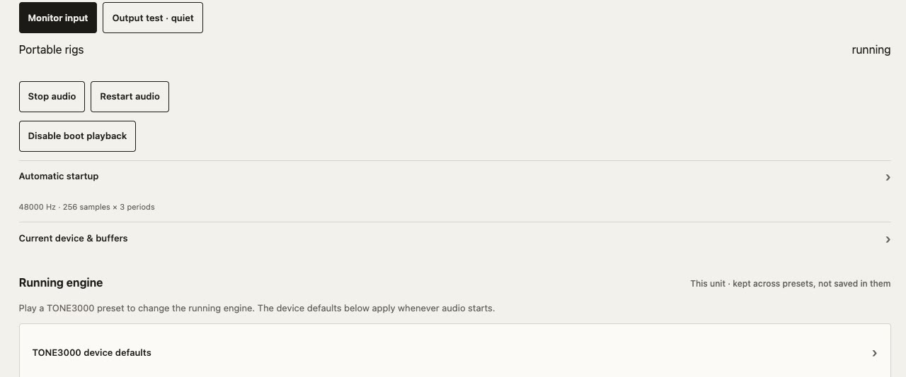](docs/assets/screenshots/running-engine.jpeg) |

| Network and hotspot                                                                                                    | TONE3000 account                                                                                                      |
| ---------------------------------------------------------------------------------------------------------------------- | --------------------------------------------------------------------------------------------------------------------- |
| [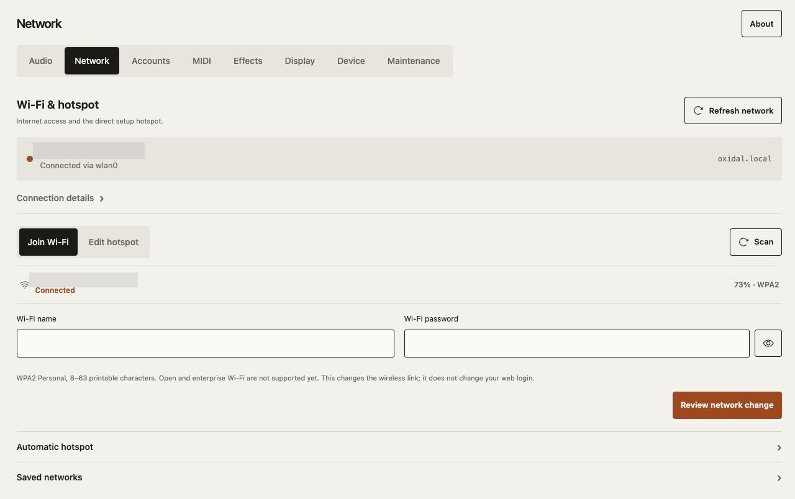](docs/assets/screenshots/settings-network.jpeg) | [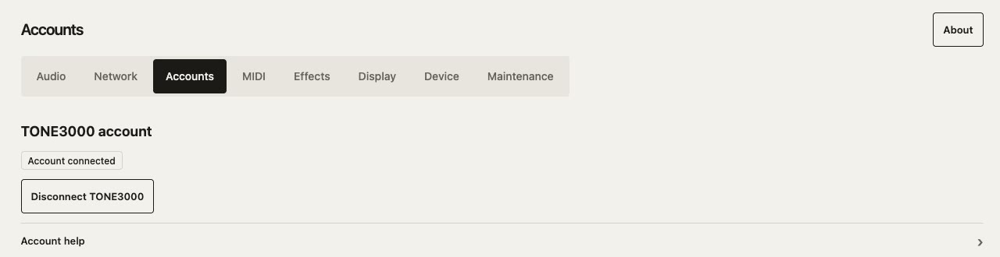](docs/assets/screenshots/settings-accounts.jpeg) |

| MIDI mapping                                                                                              | Effect packs                                                                                                    |
| --------------------------------------------------------------------------------------------------------- | --------------------------------------------------------------------------------------------------------------- |
| [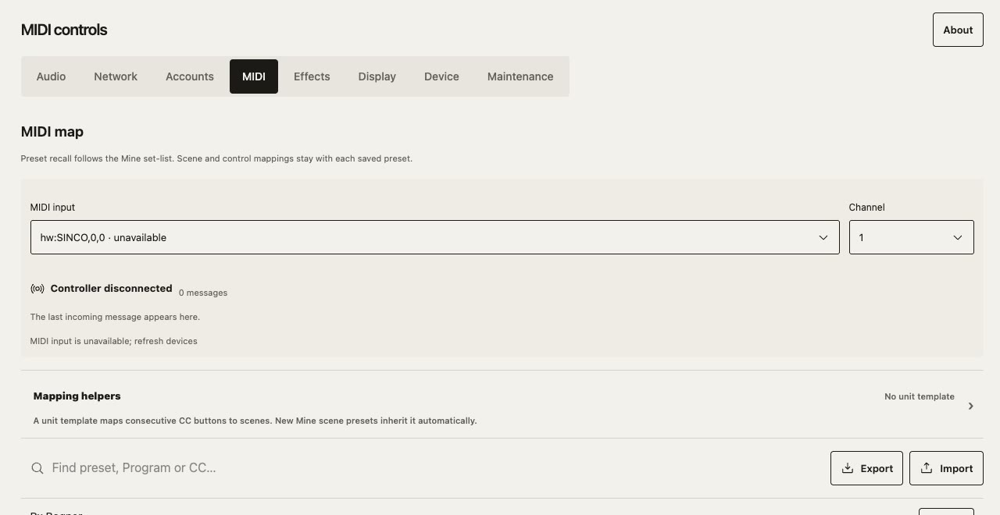](docs/assets/screenshots/settings-midi.jpeg) | [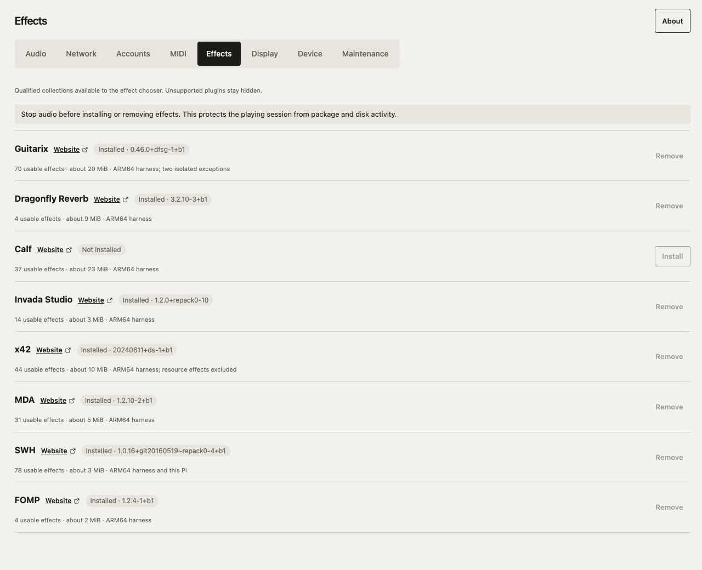](docs/assets/screenshots/settings-effects.jpeg) |

| Display modes                                                                                                    | Device storage and power                                                                                                  |
| ---------------------------------------------------------------------------------------------------------------- | ------------------------------------------------------------------------------------------------------------------------- |
| [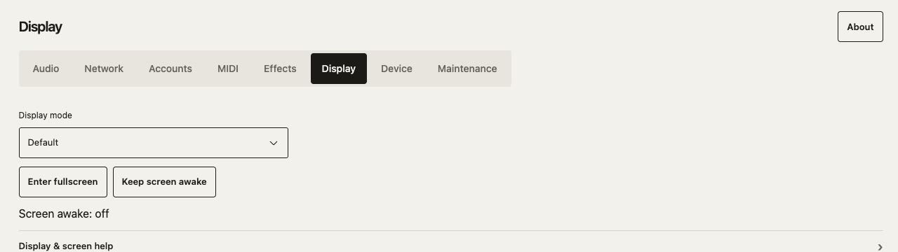](docs/assets/screenshots/settings-display.jpeg) | [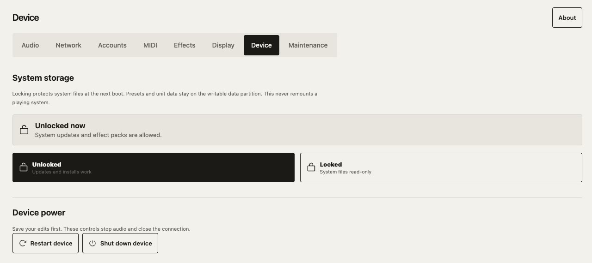](docs/assets/screenshots/settings-device.jpeg) |

### Maintenance and startup

| Expanded maintenance terminal                                                                                                            | Unprivileged CLI prompt                                                                                                  |
| ---------------------------------------------------------------------------------------------------------------------------------------- | ------------------------------------------------------------------------------------------------------------------------ |
| [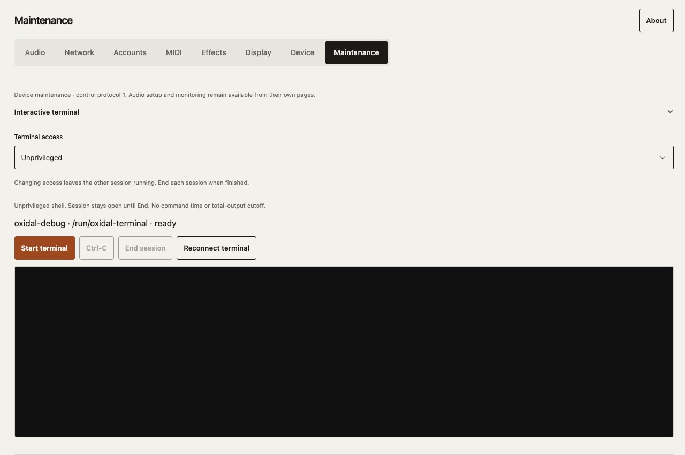](docs/assets/screenshots/settings-maintenance.jpeg) | [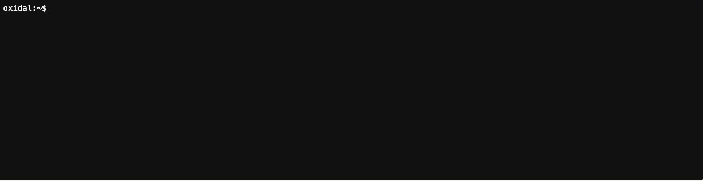](docs/assets/screenshots/terminal-prompt.jpeg) |

**Boot splash artwork** from the appliance image:

[](apps/web/public/brand/boot-splash.png)

## License

Copyright © 2026 Richard Sentino.

Oxidal's original code is licensed under the [Apache License 2.0](LICENSE). Some
optional native components use separately licensed dependencies; see
[third-party licensing](THIRD_PARTY.md) before building or distributing them.

The Oxidal name and logo are not granted under the Apache licence.
