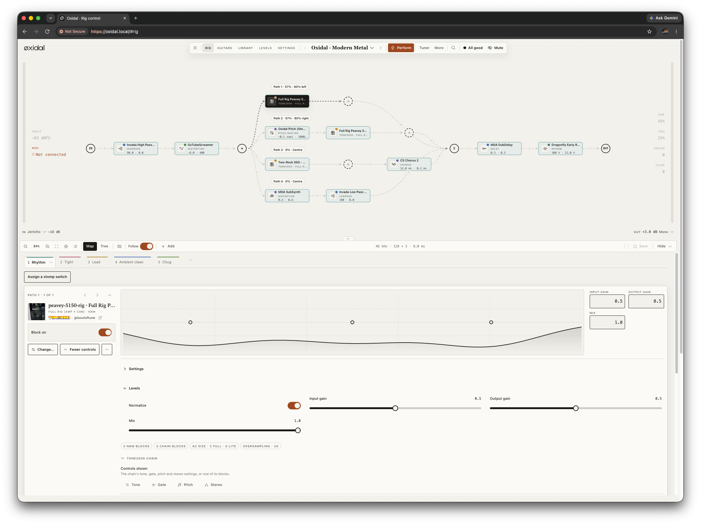
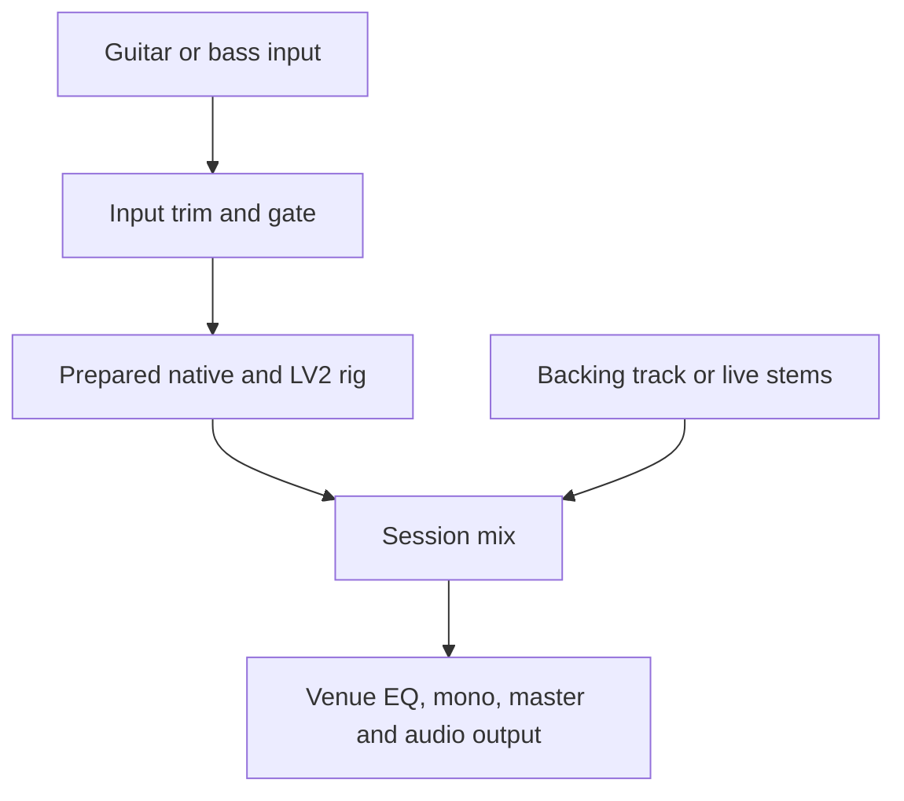
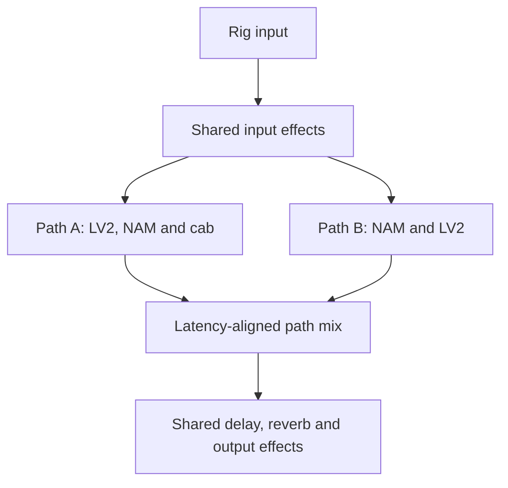

<p align="center">
  
</p>

<p align="center">
  <strong>A Linux multi-effects amp modeler for guitar and bass, built around Raspberry Pi 5.</strong>
</p>

> [!WARNING]
> Oxidal is in active development. Use a fresh SD card for Raspberry Pi testing.



Oxidal runs the audio engine, presets and library on the device. A browser on a
phone, tablet or computer controls the rig. Internet access is not required for
playing.

## What it does

- Loads Neural Amp Modeler (NAM) captures and impulse responses.
- Imports compatible TONE3000 presets without bundling third-party presets or models.
- Runs Oxidal's own LV2 effects and supported third-party LV2 plugins.
- Builds serial, parallel and scene-based rigs with MIDI control.
- Plays backing tracks, splits songs into stems and provides practice tools.
- Stores sounds, settings and recordings on the device.

## Platforms

| Platform             | Status                                                                                                                     |
| -------------------- | -------------------------------------------------------------------------------------------------------------------------- |
| Raspberry Pi 5, 8 GB | Tested hardware. The appliance image targets 64-bit Raspberry Pi OS Lite (Debian Trixie).                                  |
| Other Linux systems  | Pending testing. Oxidal is built for Linux and uses ALSA, Lilv and systemd, but other distributions are not yet qualified. |
| macOS and Windows    | Not supported as audio appliances. Their browsers can control Oxidal running on a Linux device.                            |

Hardware support is still being qualified. See the [audio guide](docs/audio.md)
and [capacity notes](docs/capacity.md) for the current limits.

## Presets and library

| Area             | What Oxidal supports                                                                                                                                      |
| ---------------- | --------------------------------------------------------------------------------------------------------------------------------------------------------- |
| Oxidal sounds    | 185 read-only rigs with serial, parallel or scene-based routing. Each sound names the tones and optional effect packs it needs.                           |
| Mine             | Editable personal presets containing NAM tones, LV2 effects, scenes, MIDI assignments and named versions.                                                 |
| TONE3000 presets | Compatible `.t3kpreset` files are checked, imported and kept in their native format. Editing creates an Oxidal-owned copy.                                |
| Set list         | Ordered and repeated preset entries with independent scene, backing-track, stem-mix and chord-sheet links.                                                |
| Backup           | Presets, local captures, impulse responses, set-list order and MIDI mappings can be downloaded from the device. Chord sheets have a separate backup file. |

See [Library](docs/library.md), [Oxidal sounds](docs/factory-collection.md) and
the [preset format](docs/presets/format.md).

## TONE3000 engine, browser and imports

Oxidal loads Neural Amp Modeler (NAM) amp, cabinet and full-rig captures. It can
also use cabinet and room impulse responses.

The native engine ports the open-source
[TONE3000 plugin](https://github.com/tone-3000/tone3000-plugin) into Oxidal's
supervised audio worker. Compatible `.t3kpreset` files can be imported into
Oxidal, edited, saved and used in native or mixed rigs. The engine is optional
because its JUCE-linked build has separate licence requirements; see
[third-party licensing](THIRD_PARTY.md).

After connecting a TONE3000 account, **Library → TONE3000** can search and
filter the live catalogue. From there:

- **Play** downloads the tone's first compatible NAM model and plays it as a
  straight capture;
- **Try through my rig** keeps the model and auditions it in a NAM block of the
  rig already playing; and
- **Get** stores the model in **Tones and IRs** for later use.

This catalogue flow downloads models. Importing a local `.t3kpreset` is the
separate full-preset path through the native TONE3000 engine. See
[TONE3000 account setup](docs/tone3000-account.md).

Oxidal does not distribute TONE3000 presets, NAM captures, impulse responses or
provider downloads. Import only assets you are allowed to use.

## How the audio engine works

One supervised worker owns the Linux audio interface. It prepares the NAM
models, LV2 plugins, routing and latency alignment before the render thread
starts. File access, model loading and control work stay outside the audio
callback.



The backing player joins after the guitar rig, so preset effects and preset
boost do not alter the backing track. Venue EQ, mono, master level and mute
apply to the combined output.

Inside a rig, the same graph supports a single serial chain or parallel paths:



A serial rig uses one path. A parallel or scene-based rig can keep several NAM
and LV2 paths prepared at once, with shared effects before or after them.

### Gapless switching

- **Scenes inside a prepared rig:** scene changes adjust path gains, bypasses
  and supported controls with sample-smoothed fades. Prepared processors stay
  running, and delay or reverb placed after the path mix can keep its tail.
- **Prepared whole rigs:** **Keep ready** loads a small set of alternatives
  before playback. They share one continuous PCM owner. Switching primes the
  incoming rig and crossfades it without loading a plugin during the switch;
  supported outgoing tails can continue until quiet.
- **Cold rig loads:** an unprepared rig is checked in an isolated worker and
  replaces the current stream only after it produces audio. This path can
  reopen the device, so Oxidal does not claim it is gapless.

The prepared switching path has automated coverage, but physical no-dropout
timing still depends on the Raspberry Pi, USB audio interface, buffer size and
rig load. See [mixed rigs and scenes](docs/mixed-engine.md) and
[audio setup](docs/audio.md).

## Oxidal effects

| Effect  | Use                           | Implementation                          |
| ------- | ----------------------------- | --------------------------------------- |
| Bloom   | Reverb                        | Original Rust LV2                       |
| Echo    | Delay and echo                | Original Rust LV2                       |
| Motion  | Modulation                    | Original Rust LV2                       |
| Moment  | Micro-looper and texture      | Original Rust LV2                       |
| Sustain | Sustained notes and chords    | Original Rust LV2                       |
| Fuzz    | Waveshaping distortion        | Original Rust LV2                       |
| Wah     | Resonant filter               | Original Rust LV2                       |
| Hold    | Spectral hold                 | Original C++ LV2                        |
| Swell   | Attack-triggered volume swell | Original C++ LV2                        |
| Pitch   | Pitch shifting                | C++ LV2 using the TONE3000 pitch engine |

The nine original effects keep their algorithm sources beside the code. Pitch
keeps the TONE3000 and JUCE terms in its component notice. See
[Oxidal effects](docs/native-effects.md) and the
[LV2 plugin catalogue](docs/lv2-plugins.md).

## Third-party LV2 plugins in factory presets

These plugins are supported by Oxidal's Linux host and referenced by the
factory preset collection. Their Debian effect packs are optional and are not
installed in a new image.

| Project                                                               | Plugins used by factory presets                                                                                                                                                                                                                |
| --------------------------------------------------------------------- | ---------------------------------------------------------------------------------------------------------------------------------------------------------------------------------------------------------------------------------------------- |
| [Guitarix](https://guitarix.org/)                                     | GxAutoWah, GxBigMuffPi, GxChorus Stereo, GxCompressor, GxDuckDelay Stereo, GxEchoCat, GxOC-2, GxPhaser, GxRat, GxReverb Stereo, GxShimmizita, GxSustainer, GxTape, GxTremolo, GxTubeDelay, GxTubeScreamer, GxTubeTremelo, GxZita Reverb Stereo |
| [Invada Studio](https://launchpad.net/invada-studio)                  | High-pass Filter Stereo, Low-pass Filter Stereo                                                                                                                                                                                                |
| [MDA LV2](https://gitlab.com/drobilla/mda-lv2)                        | Degrade, DubDelay, Leslie, RezFilter, RingMod, SubSynth, Tracker                                                                                                                                                                               |
| [SWH](http://plugin.org.uk/)                                          | Reverse Delay                                                                                                                                                                                                                                  |
| [FOMP](https://drobilla.net/software/fomp/)                           | Auto-wah, Chorus, Phaser                                                                                                                                                                                                                       |
| [Dragonfly Reverb](https://github.com/michaelwillis/dragonfly-reverb) | Hall Reverb                                                                                                                                                                                                                                    |
| [x42](https://www.x42-plugins.com/x42/)                               | Compressor Stereo                                                                                                                                                                                                                              |
| [Calf Studio Gear](https://github.com/calf-studio-gear/calf)          | Multi Chorus, Reverse Delay, Saturator, Vintage Delay                                                                                                                                                                                          |
| [DISTRHO Ports](https://github.com/DISTRHO/DPF-Plugins)               | 3 Band EQ, Cycle Shifter, MaFreeverb, MaGigaverb, MVerb, Ping Pong Pan, Soul Force                                                                                                                                                             |

LV2 support is capability-based; Oxidal does not claim that every plugin in a
collection works. The [LV2 plugin catalogue](docs/lv2-plugins.md) lists all ten
tested collections, measured plugin counts, Debian package names, project sites
and licence locations. Host limits are in the [LV2 guide](docs/lv2.md).

## Raspberry Pi appliance

The image provides:

- headless startup on Raspberry Pi OS Lite;
- USB audio and MIDI through Linux;
- a password-protected Wi-Fi hotspot and Ethernet access;
- browser control at `https://oxidal.local`;
- a separate data partition for presets and settings; and
- optional saved-session playback at boot.

See the [image and first-run guide](os/README.md).

## Stem separator and practice tools

Oxidal can separate a backing track on the Raspberry Pi, then play and mix the
stems without replacing the original song. Each stem has mute, solo and level
controls. Saved mixes can be linked to presets and set-list entries. The player
also provides waveform seeking, A–B loops, 0.5× to 1.5× speed, tempo detection
and a metronome.

| Split mode | Model         | Stems                                        |
| ---------- | ------------- | -------------------------------------------- |
| Four stems | `htdemucs`    | Vocals, drums, bass, other                   |
| Six stems  | `htdemucs_6s` | Vocals, drums, bass, guitar, piano and other |

The Pi runtime uses Rust
[`demucs-onnx` commit `757ab9f`](https://github.com/HRSadeghi/demucs-onnx/commit/757ab9face37c20edd2e08ac82410da82320763b),
CPU
[ONNX Runtime 1.23.2](https://github.com/microsoft/onnxruntime/releases/tag/v1.23.2)
and the pinned
[Demucs ONNX export revision `9128f6e`](https://huggingface.co/HRSadeghi/demucs-onnx/tree/9128f6ee0f1b8e333b5b8d12613aefb3bebc249a).
Model files are supplied separately and are not committed to this repository
because redistribution rights for the exact weights are unresolved. See
[session media and model details](docs/media.md#local-splitter-runtime).

Prepared WAV or MP3 stems can also be imported without installing the splitter
models.

## Chord sheets

**Library → Songbook** imports, writes and edits ChordPro, Markdown and plain
text sheets. A sheet can be linked to a preset or backing track and opened in
Stage or **Tools → Chord sheet**. The reader supports chord visibility, text
size, auto-scroll, page stepping for E-paper and MIDI controls for scrolling
and speed. Sheets can be exported individually or backed up and restored
together. See [chord sheets](docs/media.md#chord-sheets).

## Technology stack

| Area                  | Technologies                                      |
| --------------------- | ------------------------------------------------- |
| Audio engine and API  | Rust, Axum, Tokio                                 |
| Audio and plugins     | ALSA, Lilv, LV2, NAM, native TONE3000 integration |
| Browser interface     | React, TypeScript, Vite, Tailwind CSS             |
| Design system         | React, Storybook                                  |
| Appliance             | Raspberry Pi OS Lite, systemd, NetworkManager     |
| Local HTTPS and proxy | nginx, mDNS                                       |
| Build and checks      | pnpm, Cargo, CMake, Docker                        |

## Development

Requirements: Node.js 22.21, pnpm 10.32.1 and Rust 1.95.

```sh
rustup toolchain install 1.95.0 --profile minimal --component clippy,rustfmt
npm install --global pnpm@10.32.1
pnpm bootstrap
pnpm hooks:install
pnpm dev
```

The browser opens at `http://127.0.0.1:5173`. A Raspberry Pi is not required
for web and control work.

```sh
pnpm check
pnpm guardrails:prove
pnpm contract:check
pnpm release:dry-run
```

Start with the [documentation index](docs/README.md),
[development guide](docs/development.md) and [architecture](docs/architecture.md).

## Credits and licence

Oxidal started from local work with
[PiPedal](https://github.com/rerdavies/pipedal) and the
[TONE3000 plugin](https://github.com/tone-3000/tone3000-plugin). NAM format and
inference work refers to
[NeuralAmpModelerCore](https://github.com/sdatkinson/NeuralAmpModelerCore).

Copyright © 2026 Richard Sentino.

Oxidal's original repository code and documentation use the
[Apache License 2.0](LICENSE), except where a component says otherwise. Review
[third-party licences and notices](THIRD_PARTY.md) before building or
distributing native components. The Oxidal name and logo are not granted under
the Apache licence.
