<p align="center">
  
</p>

<p align="center">
  <strong>A multi-effects amp modeler for guitar and bass, built in Rust around Raspberry Pi 5.</strong>
</p>

<p align="center">
  Built with <a href="https://www.rust-lang.org"> Rust</a> ·
  Powered by <a href="https://www.tone3000.com"></a>
  and <a href="https://www.neuralampmodeler.com"></a> ·
  Built with <a href="https://github.com/AgenticFlowX/afx">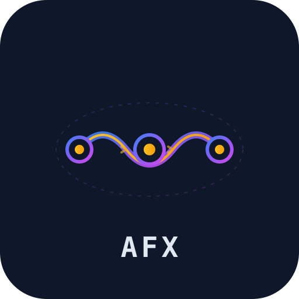 AgenticFlowX</a>
</p>

> [!WARNING]
> **Active development.** The software, installation process and hardware support are still evolving. Use a fresh SD card for Raspberry Pi experiments.

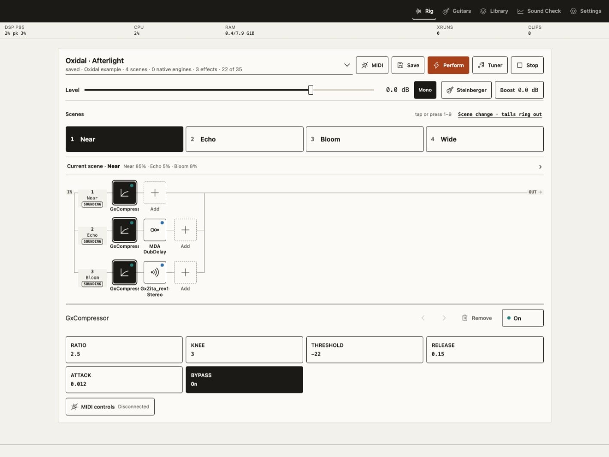

Oxidal turns a Raspberry Pi 5 and your audio interface into a complete
multi-effects rig: amp and cabinet models, effects, scenes and a Set list,
backing tracks with live stems, and practice tools, all played from a browser.

- **Tone source:** Neural Amp Modeler (NAM) captures for amp heads, cabinets and full rigs, plus impulse responses.
- **Effects:** Oxidal's own Rust LV2 effects and a qualified set of third-party LV2 plugins.
- **Control:** the browser is the controller. Processing, presets and account data stay on the device.
- **Backend:** Rust owns the control plane, library, device services and audio-worker supervision.

## Tone and effects

| Area               | What it does                                                                                                                                             | Docs                                      |
| ------------------ | -------------------------------------------------------------------------------------------------------------------------------------------------------- | ----------------------------------------- |
| NAM                | Loads licensed NAM captures (amp, cabinet, full chain); IRs for cabinet and room.                                                                        | [audio](docs/audio.md)                    |
| TONE3000 presets   | Imports compatible `.t3kpreset` files with their native rig structure. Presets and captures are not bundled.                                             | [native adapter](docs/native-tone3000.md) |
| Oxidal effects     | Bloom (reverb), Echo (delay), Motion (modulation), Sustain (infinite sustain), Hold and Swell: Oxidal's own code. Pitch ports the TONE3000 pitch engine. | [Oxidal effects](docs/native-effects.md)  |
| Third-party LV2    | Curated drive, fuzz, compression, filter, modulation, pitch, delay and reverb from Guitarix, Invada, MDA, SWH, x42, FOMP, Dragonfly, ZAM and DPF.        | [LV2 compatibility](docs/lv2.md)          |
| Factory collection | Oxidal-authored effects-only presets, sets and rigs (worship, genre and hybrid showcases).                                                               | [factory](docs/factory-collection.md)     |

- LV2 support is a qualified compatibility profile, not a claim that every LV2 plugin works.
- Not distributed: TONE3000 presets, NAM captures, IRs, provider downloads. Players supply assets they are licensed to use; test `.t3kpreset` files are parser fixtures with no model weights.
- Upstream: [Neural Amp Modeler](https://www.neuralampmodeler.com/), [TONE3000](https://www.tone3000.com/), [LV2](https://lv2plug.in/).

### Oxidal effects

| Effect                            | Modes                                                                           |
| --------------------------------- | ------------------------------------------------------------------------------- |
| [Bloom](docs/native-bloom.md)     | Room, Hall, Plate, Spring, Cloud, Bloom, Shimmer, Nonlinear                     |
| [Echo](docs/native-echo.md)       | Digital, Tape, Heads, Bucket, Reverse, Duck, Filter, Ping                       |
| [Motion](docs/native-motion.md)   | Chorus, Flanger, Phaser, Vibe, Rotary, Tremolo, Harmonic tremolo, Vibrato, Ring |
| [Sustain](docs/native-sustain.md) | Normal, Harmonic, Mix (note blooms into a harmonic); follows bends and vibrato  |
| [Hold](docs/native-hold.md)       | Spectral freeze: held notes ring as a drone                                     |
| [Swell](docs/native-swell.md)     | Auto-swell: each note fades in                                                  |
| [Pitch](docs/native-pitch.md)     | Pitch shifting                                                                  |

## Playing live

- **Rigs:** native processors and LV2 effects in serial, parallel and scene-based paths.
- **Scenes and MIDI:** preloaded scenes, switched from the browser or a mapped MIDI controller; supported layouts keep delay and reverb trails.
- **Sound Check:** interface setup, level matching, live audio and processing health.
- **Backing tracks and stems:** play WAV or MP3 songs over your rig, split them into 4 or 6 stems on the device, and mute or level each part as it plays. See [session media](docs/media.md).
- **Practice:** A–B loops, 0.5× to 1.5× speed that keeps pitch, and a click that follows the song.

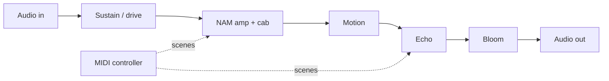

## Raspberry Pi appliance

| Feature            | Details                                                                                                                         |
| ------------------ | ------------------------------------------------------------------------------------------------------------------------------- |
| Custom Linux image | Headless Pi 5 image on [Raspberry Pi OS Lite](https://www.raspberrypi.com/software/operating-systems/) (64-bit, Debian Trixie). |
| Wi-Fi and Ethernet | Built-in password-protected hotspot; can also join Wi-Fi or use Ethernet.                                                       |
| Browser control    | `https://oxidal.local` after installing the device certificate; generated credentials. Works offline.                           |
| Persistent storage | Presets and settings on a separate data partition.                                                                              |
| Boot playback      | Optional: load a saved session at startup.                                                                                      |

- Setup: [image build and setup guide](os/README.md#phone-access-and-first-sound).
- Limits (NAM models, effects, buffer sizes on a Pi 5 with a USB interface): [capacity guide](docs/capacity.md).

## Architecture

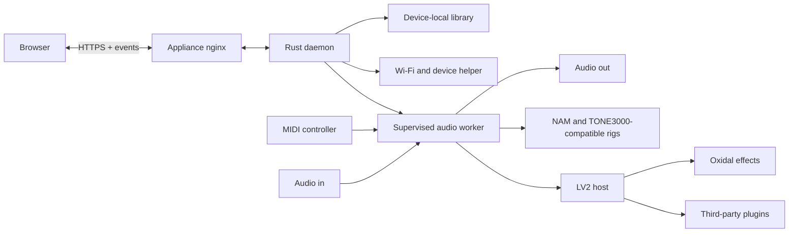

- Control plane: API, library, device settings.
- One supervised worker owns the audio interface.
- Details: [architecture guide](docs/architecture.md).

## Tech stack

| Layer              | Technologies                                         | Role                                                        |
| ------------------ | ---------------------------------------------------- | ----------------------------------------------------------- |
| Web interface      | React, TypeScript, Vite, Tailwind CSS                | Rig editing, performance, device setup.                     |
| Backend            | Rust, Axum, Tokio                                    | Local HTTP API, event streams, library, worker supervision. |
| Audio and DSP      | ALSA, NAM, native TONE3000 integration, LV2, Rust    | Audio I/O, capture playback, effect hosting, own effects.   |
| Appliance services | Raspberry Pi OS Lite, systemd, NetworkManager, nginx | Headless boot, services, Wi-Fi/hotspot, HTTPS.              |

## How it is built

Oxidal is built with [AgenticFlowX](https://github.com/AgenticFlowX/afx)
spec-driven development. Every feature starts as a spec, design and task list,
and the code links back to those documents with `@see` references.

## Rust crates

| Crate                                           | What it does                                                            |
| ----------------------------------------------- | ----------------------------------------------------------------------- |
| [`oxidal-api`](crates/oxidal-api)               | Daemon: web UI, API, audio-worker supervision.                          |
| [`oxidal-audio`](crates/oxidal-audio)           | Linux audio device discovery, probing and ALSA streaming.               |
| [`oxidal-control`](crates/oxidal-control)       | Rig controls, MIDI mappings, control state machine.                     |
| [`oxidal-debug`](crates/oxidal-debug)           | Maintenance commands in a separate service.                             |
| [`oxidal-device`](crates/oxidal-device)         | Wi-Fi, hotspot, power and effect-pack management.                       |
| [`oxidal-engine`](crates/oxidal-engine)         | Mixed rigs: native tones, LV2 effects, preloaded scenes.                |
| [`oxidal-graph`](crates/oxidal-graph)           | Signal-routing validation shared by the engines.                        |
| [`oxidal-lv2`](crates/oxidal-lv2)               | LV2 discovery and hosting on Linux.                                     |
| [`oxidal-nam`](crates/oxidal-nam)               | NAM inference in Rust for supported architectures.                      |
| [`oxidal-presets`](crates/oxidal-presets)       | Presets, rig bundles and local model assets.                            |
| [`oxidal-tone3000`](crates/oxidal-tone3000)     | Native TONE3000 engine wrapper for compatible presets.                  |
| [`oxidal-dsp`](crates/oxidal-dsp)               | Shared DSP blocks for Oxidal effects (delay lines, filters, smoothing). |
| [`oxidal-lv2-plugin`](crates/oxidal-lv2-plugin) | Safe `Plugin` trait and LV2 export macro for Oxidal effects.            |
| [`oxidal-bloom`](crates/oxidal-bloom)           | Bloom reverb plugin.                                                    |
| [`oxidal-echo`](crates/oxidal-echo)             | Echo delay plugin.                                                      |
| [`oxidal-motion`](crates/oxidal-motion)         | Motion modulation plugin.                                               |
| [`oxidal-sustain`](crates/oxidal-sustain)       | Sustain plugin.                                                         |

## Development

- Toolchain: Node 22.21.0, pnpm 10.32.1, Rust 1.95.0.
- No Raspberry Pi needed for browser and control-plane work.

```sh
rustup toolchain install 1.95.0 --profile minimal --component clippy,rustfmt
npm install --global pnpm@10.32.1
pnpm bootstrap
pnpm hooks:install
pnpm dev            # http://127.0.0.1:5173
```

```sh
pnpm check
pnpm guardrails:prove
pnpm contract:check
pnpm release:dry-run
```

- Next: [documentation index](docs/README.md), [development guide](docs/development.md), [web interface](apps/web/README.md), [appliance image guide](os/README.md).

## Screenshot gallery

Captured on a running appliance; the Wi-Fi network name is redacted. Click to enlarge.

### Playing and monitoring

| Perform                                                                                                        | Effect controls                                                                                                          |
| -------------------------------------------------------------------------------------------------------------- | ------------------------------------------------------------------------------------------------------------------------ |
| [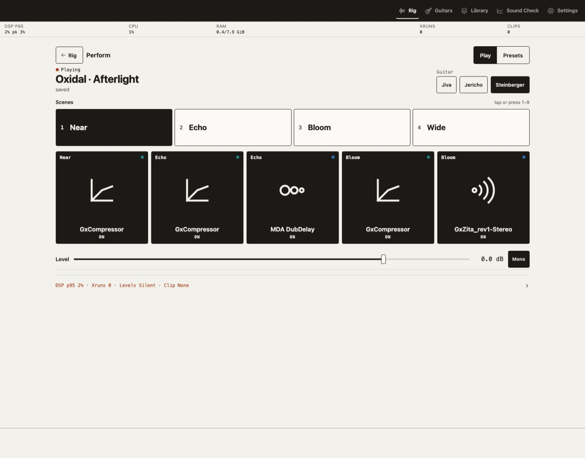](docs/assets/screenshots/perform-afterlight.jpeg) | [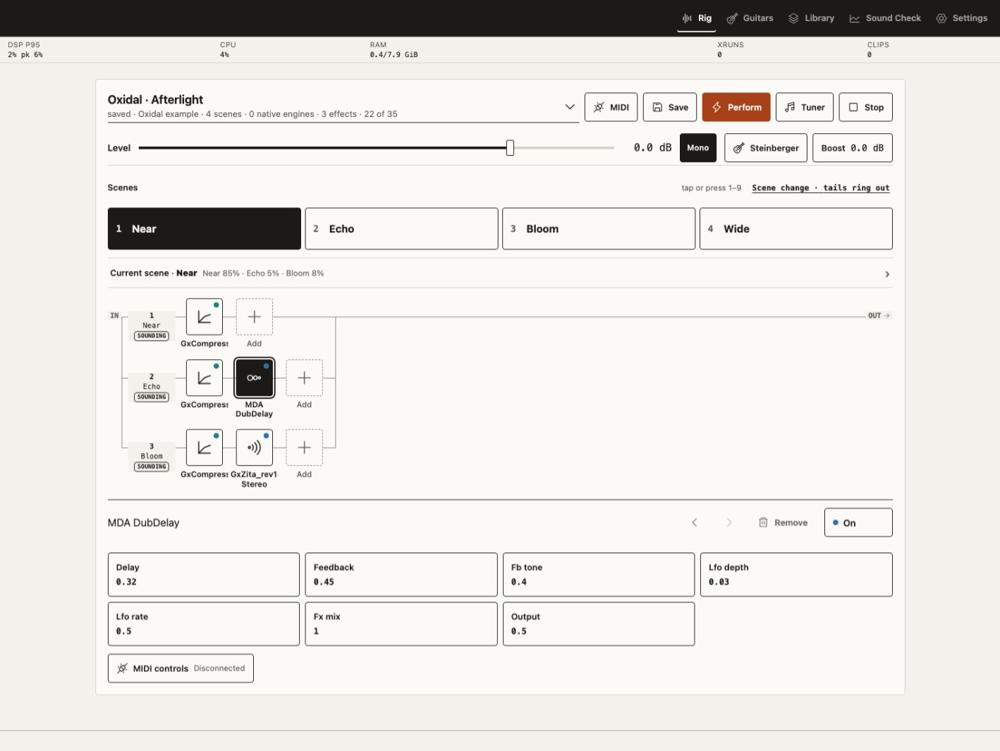](docs/assets/screenshots/rig-effect-controls.jpeg) |

| Sound Check overview                                                                                          | Live diagnostics                                                                                                                  |
| ------------------------------------------------------------------------------------------------------------- | --------------------------------------------------------------------------------------------------------------------------------- |
| [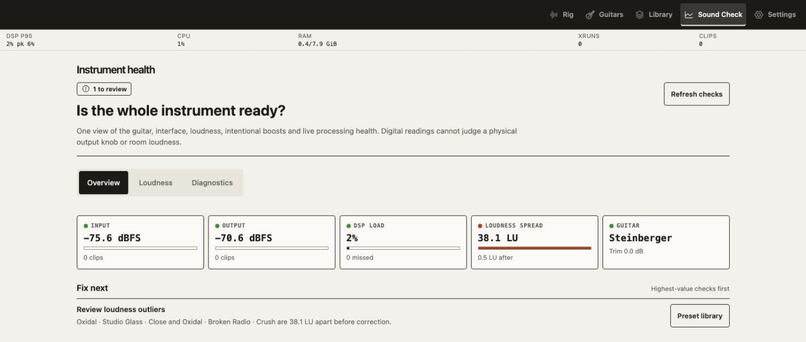](docs/assets/screenshots/sound-check.jpeg) | [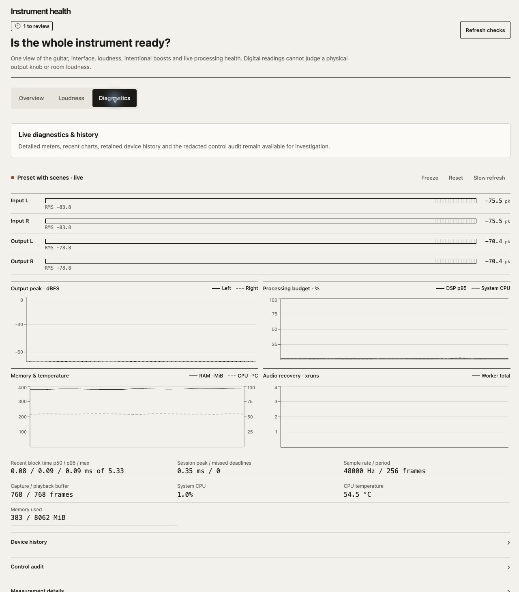](docs/assets/screenshots/sound-check-diagnostics.jpeg) |

### Settings

| Audio setup                                                                                                | Running engine                                                                                                |
| ---------------------------------------------------------------------------------------------------------- | ------------------------------------------------------------------------------------------------------------- |
| [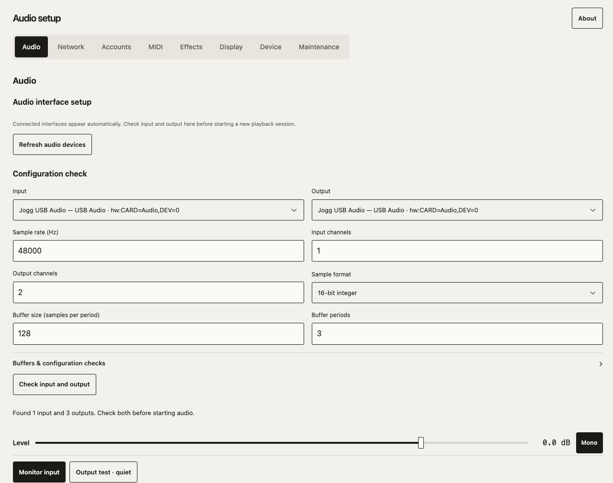](docs/assets/screenshots/settings-audio.jpeg) | [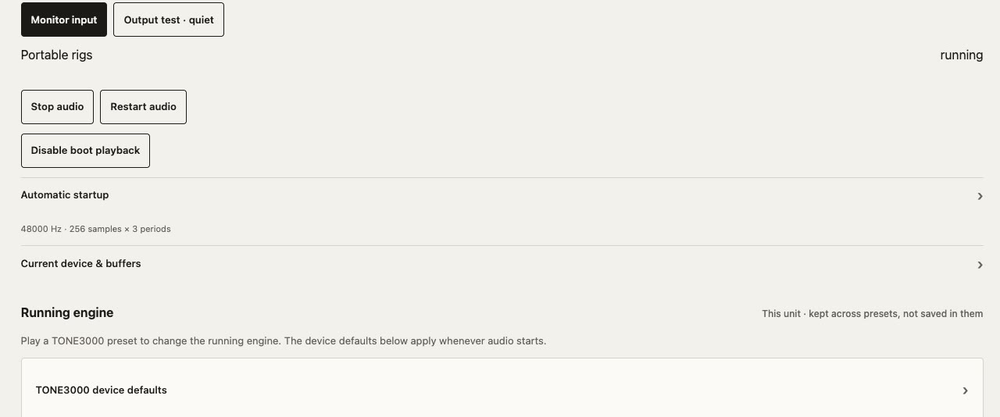](docs/assets/screenshots/running-engine.jpeg) |

| Network and hotspot                                                                                                    | TONE3000 account                                                                                                      |
| ---------------------------------------------------------------------------------------------------------------------- | --------------------------------------------------------------------------------------------------------------------- |
| [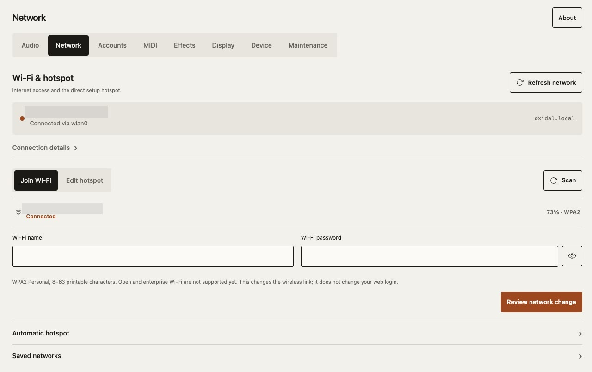](docs/assets/screenshots/settings-network.jpeg) | [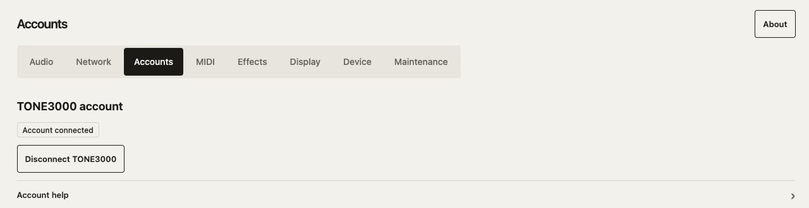](docs/assets/screenshots/settings-accounts.jpeg) |

| MIDI mapping                                                                                              | Effect packs                                                                                                    |
| --------------------------------------------------------------------------------------------------------- | --------------------------------------------------------------------------------------------------------------- |
| [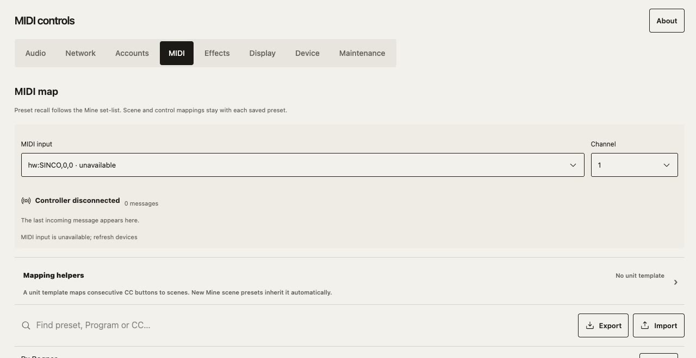](docs/assets/screenshots/settings-midi.jpeg) | [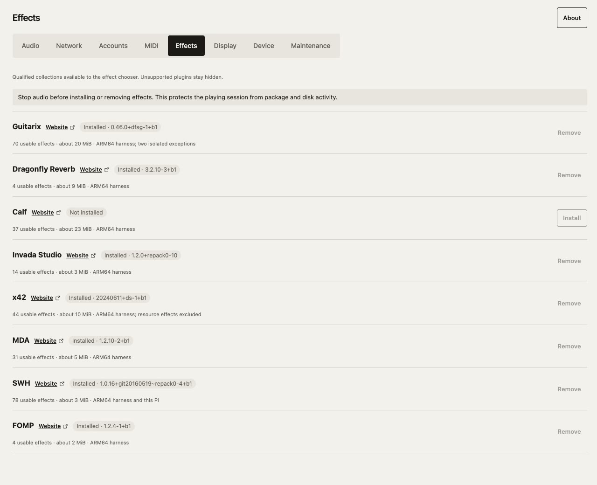](docs/assets/screenshots/settings-effects.jpeg) |

| Display modes                                                                                                    | Device storage and power                                                                                                  |
| ---------------------------------------------------------------------------------------------------------------- | ------------------------------------------------------------------------------------------------------------------------- |
| [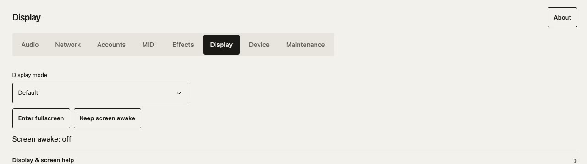](docs/assets/screenshots/settings-display.jpeg) | [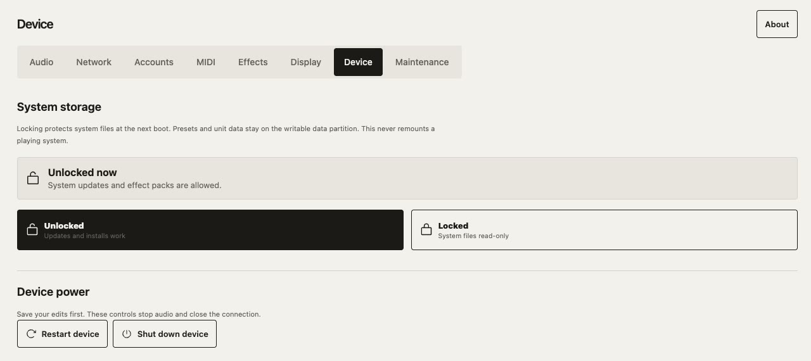](docs/assets/screenshots/settings-device.jpeg) |

### Maintenance and startup

| Expanded maintenance terminal                                                                                                            | Unprivileged CLI prompt                                                                                                  |
| ---------------------------------------------------------------------------------------------------------------------------------------- | ------------------------------------------------------------------------------------------------------------------------ |
| [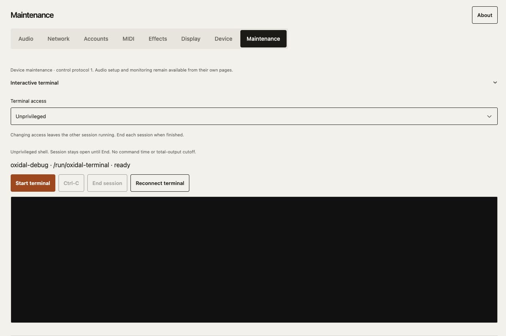](docs/assets/screenshots/settings-maintenance.jpeg) | [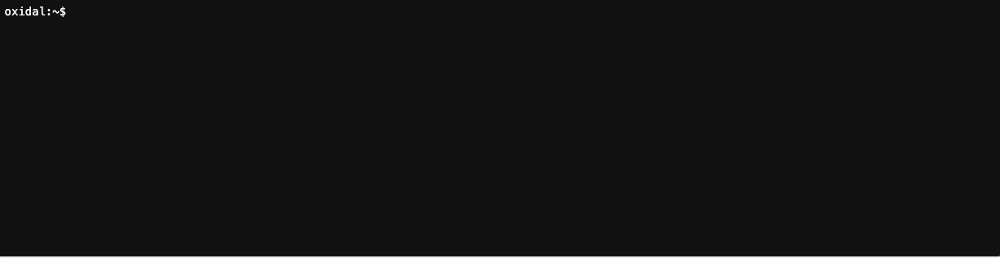](docs/assets/screenshots/terminal-prompt.jpeg) |

**Boot splash artwork** from the appliance image:

[](apps/web/public/brand/boot-splash.png)

## Acknowledgments

Initial work started locally on [PiPedal](https://github.com/rerdavies/pipedal) and the [TONE3000 plugin](https://github.com/tone-3000/tone3000-plugin). Thanks to both projects and their contributors.

- [Archived PiPedal integration](https://github.com/rixrix/pipedal/pull/1)
- [Archived TONE3000 stage bridge](https://github.com/rixrix/tone3000-plugin/pull/1)

## License

Copyright © 2026 Richard Sentino.

- Original code: [Apache License 2.0](LICENSE).
- Some optional native components use separately licensed dependencies: see [third-party licensing](THIRD_PARTY.md) before building or distributing them.
- The Oxidal name and logo are not granted under the Apache licence.
