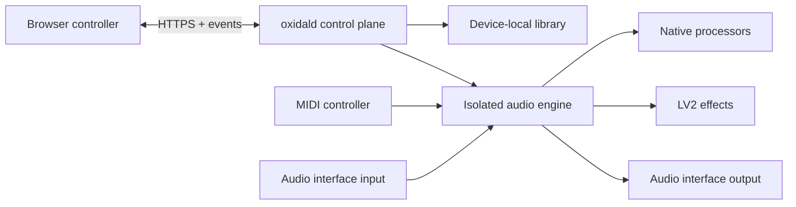

# Oxidal


> **Active development:** Oxidal is an early, working prototype. APIs, preset formats,
> installation steps and hardware support can change before the first stable release.

Oxidal turns a Raspberry Pi 5 and a USB audio interface into a device-local guitar
and bass processor. It combines neural amp captures, impulse responses and LV2
effects in serial, parallel and scene-based rigs, controlled from a browser.


The current appliance runs live audio, recalls prepared scenes, hosts supported LV2
effects, manages guitar profiles and MIDI mappings, and reports audio health through
Sound Check. Hardware and real-time qualification are still in progress; see
[Project status](#project-status) before using Oxidal on stage.

## Repositories

Oxidal is planned as **two repositories** in the
[oxidalhq organization](https://github.com/oxidalhq):

1. **`oxidal`** — this repository: software, web interface, appliance image recipes
   and product documentation.
2. **`oxidal-controller`** — controller firmware, PCB design and enclosure files.

Documentation and example rigs stay with the product they describe. We do not plan
separate documentation, preset or website repositories for the initial release.

## What it does

- Builds serial, parallel and scene-based signal paths from native processors and
  supported LV2 effects.
- Keeps audio processing, presets and account data on the device while the browser
  acts as the controller.
- Prepares scene changes before performance and supports trails or blended changes
  without rebuilding the rig on each switch.
- Provides guitar profiles, MIDI control, loudness matching, device setup and live
  processing diagnostics.
- Produces a relocatable Linux application bundle and an experimental Raspberry Pi
  OS image from pinned inputs.

Oxidal does **not** distribute TONE3000 presets, NAM captures, impulse responses or
provider downloads. Factory images contain Oxidal-authored effects-only examples;
players add assets they are licensed to use. The three `.t3kpreset` files in the test
suite are tiny project-authored parser fixtures with no model weights or playable
tone.

## Architecture



The control plane handles the API, library and device settings. Audio runs in an
isolated worker with one owner for the audio interface. See the
[architecture guide](docs/architecture.md) for the contracts and process boundaries.

| Path        | Content                                                                                      |
| ----------- | -------------------------------------------------------------------------------------------- |
| `crates/`   | Graph validation, control state, HTTP/SSE API, native preset storage and owned NAM inference |
| `apps/web/` | React/TypeScript interface and browser integration tests                                     |
| `os/`       | Pinned Trixie base manifest and safe provisioning recipe                                     |
| `scripts/`  | Reproducible development, verification and packaging commands                                |
| `docs/`     | [Product architecture and contributor documentation](docs/README.md)                         |

## Project status

Oxidal targets **x86-64 Linux** and **Raspberry Pi ARM64**. Orange Pi remains a
board-specific candidate. The portable application and board images have separate
installation and qualification paths; see the
[Linux target plan](os/README.md#target-installation-routes).

Automated checks cover the Rust services, browser application, contracts, packaging
and isolated native/LV2 workers. Physical audio interfaces, real-time performance,
controller hardware, recovery and installation still need broader device testing.
Use a fresh, separate SD card for Pi experiments; do not overwrite a working system.

## Run locally

Use Node **22.21.0**, pnpm **10.32.1**, and Rust **1.95.0**. On a fresh machine:

```sh
rustup toolchain install 1.95.0 --profile minimal --component clippy,rustfmt
# Install/select Node 22.21.0 with your existing Node version manager.
npm install --global pnpm@10.32.1
# macOS shell checks; disable unrelated Homebrew updates/cleanup.
HOMEBREW_NO_AUTO_UPDATE=1 HOMEBREW_NO_INSTALL_CLEANUP=1 brew install shellcheck shfmt
pnpm bootstrap
pnpm hooks:install
pnpm dev
```

On Linux, install ShellCheck, shfmt, `libasound2-dev` and `pkg-config` with the distribution package manager (Debian/Ubuntu names). `pnpm bootstrap` performs locked dependency installation, installs workspace-local Rust dependency tools and Chromium, and fetches native dependencies. Browser system dependencies may also be needed on Linux (`pnpm --dir apps/web exec playwright install --with-deps chromium`).

Open **http://127.0.0.1:5173**. Rust runs on port 3210 and Vite proxies the
versioned API. The development service listens on loopback only; no Pi is needed.
See [development](docs/development.md), [web](apps/web/README.md),
[OS recipes](os/README.md) and [the NAM crate](crates/oxidal-nam/README.md).

## Screenshots

| Perform                                                                 | Sound Check                                                     |
| ----------------------------------------------------------------------- | --------------------------------------------------------------- |
|  |  |

See the [screenshot gallery](docs/screenshots.md) for the full rig and effect-control
views.

## Verify and prepare releases

```sh
pnpm check
pnpm guardrails:prove
pnpm contract:check
pnpm release:dry-run
```

Stop `pnpm dev` before e2e/aggregate checks; tests own their local service and ports. Run the negative-fixture proof separately from other checks. See [development and release policy](docs/development.md) for checks and versioning. Nothing is pushed or published by these local commands.

The [draft Oxidal preset specification](docs/presets/format.md) describes native TONE3000 preservation, mixed rigs and explicit conversion/export rules. Run `pnpm presets:check` for manifest/schema checks; this does not establish runtime compatibility.

### Optional native preset editing

After `pnpm native:check` builds and verifies the pinned native backend on macOS or Linux, run `OXIDAL_NATIVE_EDITOR=1 pnpm preview`. Library provides real preset load, preview/cancel/commit, owned-copy save and reload. Five controls are qualified in this slice; imported originals stay immutable. Experimental Linux playback uses a separate worker; physical audio and full settings parity remain pending. See [native editor](docs/native-tone3000.md).

Linux builds expose **Settings → Audio → Audio devices** for real ALSA discovery and exact configuration probes. The appliance also includes experimental saved-preset playback with audio-only Start/Stop/Restart; physical audio remains unqualified. See [audio devices and lifecycle](docs/audio.md).

The appliance’s [device service](docs/device-service.md) supplies web Wi-Fi/hotspot setup with rollback, fixed effect-package actions and separate system power controls. Its deliberate package-manager privilege exception and retained safeguards are documented in the [OS README](os/README.md#effect-installation-and-helper-hardening). [Monitoring](docs/monitoring.md) shows real worker levels, processing history and available Linux host readings. The optional [web debug console](docs/debug-console.md) runs bounded commands as a separate unprivileged account after explicit enablement.

The interface keeps Rig, Guitars, Library, Sound Check and Settings as stable
destinations. Settings separates Audio, Network, Accounts, MIDI, Effects, Display,
Device and Maintenance. See [interface theme and navigation](docs/interface.md).
