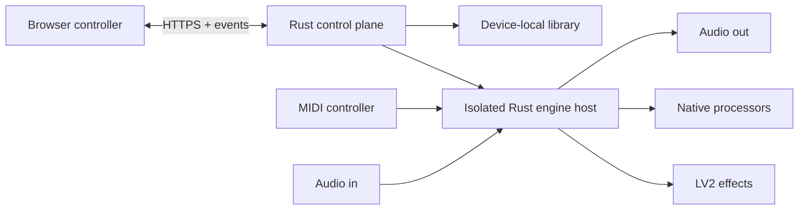

<p align="center">
  
</p>

<p align="center">
  <strong>A Rust-powered, device-local guitar and bass processor built around Raspberry Pi 5.</strong>
</p>

<p align="center">
  <em>Active development — the software, installation process and hardware support are still evolving.</em>
</p>


Oxidal combines neural amp captures, impulse responses and LV2 effects in playable
rigs with prepared scenes. Its Rust backend owns the control plane, library, device
services and audio-engine supervision. The browser is the controller; processing,
presets and account data stay on the device.

## Made to play

- **Flexible rigs** — arrange native processors and supported LV2 effects in serial,
  parallel and scene-based signal paths.
- **Performance-first switching** — prepare scenes and alternate rigs before the
  show, with trails and blended changes where the processing graph supports them.
- **A complete instrument** — guitar profiles, MIDI control, audio setup, loudness
  matching and live processing health belong to the same device.
- **Rust at the core** — typed contracts connect the web interface to Rust services
  and an isolated Rust engine host, with native DSP kept behind explicit boundaries.

| Perform                                                                 | Sound Check                                                     |
| ----------------------------------------------------------------------- | --------------------------------------------------------------- |
|  |  |

[See more screenshots](docs/screenshots.md)

## Two repositories

Oxidal is intentionally split into two repositories in the
[oxidalhq organization](https://github.com/oxidalhq):

- **`oxidal`** — software, browser interface, appliance image recipes and product
  documentation. This repository.
- **`oxidal-controller`** — controller firmware, PCB design and enclosure files.

There is no separate documentation or preset repository. Documentation stays with
the product it describes.

## Architecture



The control plane owns the API, library and device settings. A supervised worker is
the single owner of the audio interface. Read the
[architecture guide](docs/architecture.md) for process boundaries and contracts.

## Current status

The working appliance runs live audio, supports prepared scene recall and supported
LV2 effects, and exposes guitar, MIDI, audio and health workflows in the browser.
Automated checks cover the Rust services, web application, contracts, packaging and
isolated audio workers.

Oxidal targets x86-64 Linux and Raspberry Pi ARM64. Physical-interface coverage,
real-time qualification, recovery and installation across supported hardware remain
in progress. Use a fresh SD card for Raspberry Pi experiments.

Oxidal does not distribute TONE3000 presets, NAM captures, impulse responses or
provider downloads. Factory images contain Oxidal-authored effects-only examples;
players supply assets they are licensed to use. The tiny `.t3kpreset` files in the
test suite are project-authored parser fixtures with no model weights or playable
tone.

## Development

Use Node 22.21.0, pnpm 10.32.1 and Rust 1.95.0.

```sh
rustup toolchain install 1.95.0 --profile minimal --component clippy,rustfmt
npm install --global pnpm@10.32.1
pnpm bootstrap
pnpm hooks:install
pnpm dev
```

Open <http://127.0.0.1:5173>. No Raspberry Pi is required for browser and control
plane development.

```sh
pnpm check
pnpm guardrails:prove
pnpm contract:check
pnpm release:dry-run
```

Start with the [documentation index](docs/README.md),
[development guide](docs/development.md), [web interface](apps/web/README.md) or
[appliance image guide](os/README.md).

## License

Oxidal's original code is licensed under the [Apache License 2.0](LICENSE). Some
optional native components use separately licensed dependencies; see
[third-party licensing](THIRD_PARTY.md) before building or distributing them.

The Oxidal name and logo are not granted under the Apache licence.
