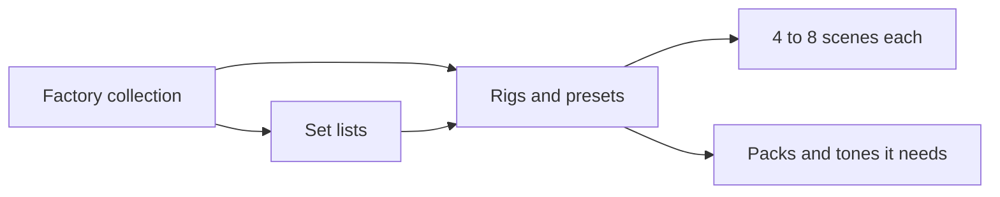

# Oxidal sounds

The factory collection: 185 finished rigs authored by Oxidal, in **Library → Oxidal sounds**. Each ships its chain, settings, scenes and levels. Oxidal ships no third-party captures, presets or effect packs; a sound names what it needs and installs it in one step. Oxidal's own effects are described in [Oxidal effects](native-effects.md).

- Read-only examples: **Make my copy** puts an editable copy in **Mine**.
- Search by name; filter by **Genre**, **Engine** and **Complexity**; group by genre or engine.
- **Details** shows the description, inspiration, a listening guide, how to play it, scenes, chain, needs and load, and **Add to set list** once ready.

## Card states

| State          | Primary action      | Meaning                                                            |
| -------------- | ------------------- | ------------------------------------------------------------------ |
| Ready          | Play                | Everything it needs is installed. The card lists its scenes.       |
| Tones needed   | Get tones           | Needs tones from your TONE3000 account.                            |
| Sign-in needed | Sign in to TONE3000 | Tones are needed and no account is connected.                      |
| Packs needed   | Install pack        | Needs an [effect pack](device-service.md#effect-packs).            |
| Too heavy      | none                | More captures than the audio stream carries at the current buffer. |
| Not available  | none                | This unit does not have a plugin the sound uses.                   |

- **Install pack** is disabled, with the reason, while Protect is on or audio is running.
- When **Install pack** or **Get tones** finishes, every sound that install completed is saved and its level matched (silently, a few seconds per scene).
- A sound that already had everything is saved the first time you play it and starts at once; match its level later with **Even out** in Levels.
- **Capture budget** (measured on a Pi 5): at 96 frames, four A2 Lite or three A2 Full instances, in proportion to the buffer. The LV2 load in Details (about 1.5 % of a buffer per block) is a planning figure. See [capacity](capacity.md).

## Recipe metadata

| Field                 | Meaning                                                                                                                                     |
| --------------------- | ------------------------------------------------------------------------------------------------------------------------------------------- |
| Genres                | One to three from a fixed list of 17.                                                                                                       |
| Techniques            | Routing and effect techniques, such as parallel routing or Hold.                                                                            |
| Era                   | Songbook sounds only: 80s, 90s, 2000s or Modern.                                                                                            |
| Engine                | LV2 only, A2 Lite, A2 Full (TONE3000 tones) or Hybrid.                                                                                      |
| Complexity            | Simple, Layered or Complex.                                                                                                                 |
| Inspiration           | A style and an era. The separate listening guide may name an artist and song as a musical comparison, without claiming an exact recreation. |
| Performance           | How the scenes are meant to be used live.                                                                                                   |
| Required packs, tones | Derived from the sound's blocks and voices.                                                                                                 |

| Engine   | Sounds |
| -------- | ------ |
| LV2 only | 57     |
| A2 Lite  | 29     |
| A2 Full  | 23     |
| Hybrid   | 76     |

## Set lists

| Set list            | Purpose                                                                           | In order                                                                                                                                                        |
| ------------------- | --------------------------------------------------------------------------------- | --------------------------------------------------------------------------------------------------------------------------------------------------------------- |
| Oxidal effects tour | A suggested order for trying the four effects; only the limit rig needs captures. | Everything On (OX-LIMIT), Eight Rooms (OX-01), Endless Bow (OX-07), Dotted Clock (OX-14), Eight Motions (OX-19), Tape Loop Diary (OX-13), Glass Ceiling (OX-02) |
| Worship service     | A Sunday service: clean verse to shimmer pad, then sustained leads.               | Sunday Morning (OX-25), Infinite Clean (OX-11), Glass Ceiling (OX-02), Violin Lead (OX-10)                                                                      |

Add either set in one step from **Library → Set list** (**Add Oxidal effects tour**, **Add Worship service**).

One setup per genre:

| Genre           | Setup                    |
| --------------- | ------------------------ |
| Clean           | Clean Ensemble (OX-24)   |
| Edge of breakup | Breakup Point (OX-29)    |
| Funk            | Tight Pocket (OX-30)     |
| Blues           | Smoky Corner (OX-31)     |
| Country         | Slap Ranch (OX-32)       |
| Jazz            | Warm Room (OX-33)        |
| Pop             | Dotted Clock (OX-14)     |
| Classic rock    | Tape and Plate (OX-34)   |
| Hard rock       | Ducked Solo (OX-35)      |
| Modern metal    | Iron Gate (OX-36)        |
| Progressive     | Odd Meter (OX-37)        |
| Ambient         | Glass Ceiling (OX-02)    |
| Post-rock       | Tide Wall (OX-38)        |
| Synth           | Glass Oscillator (OX-39) |
| Bass            | Low Chorus (OX-40)       |
| Lo-fi           | Warped Cassette (OX-41)  |
| Experimental    | Bell Machine (OX-42)     |

- **Limit rigs:** Everything On (OX-LIMIT) fills the A2 Lite capture budget: Sustain and a boost feed four amps side by side, then Motion, Echo and Bloom; eight scenes re-mix the amps and change all four effects. Everything On Full (OX-LIMIT-F) is the same with three amps for A2 Full. Check the load in Details before playing live.
- **Service rig** (Sunday Morning, OX-25): eight scenes from clean verse, dotted-eighth echo and lead to swell pad, shimmer pad, frozen tail and soft tremolo. Set its echo BPM to the song.
- **Rhythm and lead rigs** (OX-27, OX-28): a short echo and a room for rhythm; Sustain, a longer echo and a bigger reverb for lead.

## Catalogue

Columns come from each recipe: the first sentence of its inspiration and of its description.

### Oxidal effects (45)

Built around Oxidal Bloom, Sustain, Echo and Motion. OX-01 to OX-24 feature one effect each (Sustain before drive and amp, Motion and Echo after the amp, Bloom last); OX-25 to OX-42 combine them; OX-43 walks through Oxidal Moment on one caught loop; OX-LIMIT and OX-LIMIT-F are the limit rigs.

| ID         | Name                  | Engine   | Genres                               | Scenes | Style and inspiration                                                                                                                                                                   | What it is                                                                                                                                                                |
| ---------- | --------------------- | -------- | ------------------------------------ | ------ | --------------------------------------------------------------------------------------------------------------------------------------------------------------------------------------- | ------------------------------------------------------------------------------------------------------------------------------------------------------------------------- |
| OX-01      | Eight Rooms           | LV2 only | Clean, Ambient                       | 5      | Studio reverbs from the 1960s to the 1990s heard one after another on the same clean part: a tracking room, a concert hall, a steel plate and the long washes of later rack units.      | A compressed clean guitar and a swell pad through one reverb that changes voice with the scene: room, hall, plate, cloud and a tail that swells.                          |
| OX-02      | Glass Ceiling         | LV2 only | Ambient, Post-rock                   | 6      | Ambient and worship-style guitar from the 1980s onward: slow chords under a reverb whose tail climbs in pitch like a choir or a string pad.                                             | A clean guitar under a shimmering reverb: the tail rises an octave or a fifth, or sinks an octave, and one scene holds it.                                                |
| OX-03      | Tank Drip             | Hybrid   | Country, Clean                       | 6      | Instrumental guitar records of the early 1960s: a clean combo, heavy strings picked hard near the bridge and a spring tank turned up until it splashes.                                 | A bright clean combo into a spring tank that drips and splashes, with a slapback and a tremolo scene.                                                                     |
| OX-04      | Gated Room            | Hybrid   | Hard rock, Pop                       | 5      | Big rock and pop production of the 1980s: a loud stack in a live room whose reverb is cut off sharply after every chord, and the reversed swells of the same years.                     | A hot rock stack with a reverb that stops dead, plays backwards or rises and falls instead of fading.                                                                     |
| OX-05      | Slow Bloom            | A2 Lite  | Ambient, Post-rock                   | 6      | Instrumental post-rock of the late 1990s and 2000s: sparse clean notes that grow into a wall of reverb some seconds after they are played.                                              | A clean amp and a smooth overdriven amp into a reverb whose tail swells up after the note, then thickens as it fades.                                                     |
| OX-06      | Cathedral Cloud       | A2 Full  | Ambient, Clean                       | 5      | Ambient guitar of the 1980s and after: a very clean solid-state amp feeding reverbs so long that chords overlap into one slow-moving texture.                                           | A flat, wide clean amp and a swell pad in a very large, slow reverb, from a hall to a wash that lasts a minute.                                                           |
| OX-07      | Endless Bow           | LV2 only | Ambient, Experimental                | 5      | Bowed and magnetically sustained guitar from the 1970s onward: single notes held for as long as the hand stays on the string, like a cello line.                                        | A clean guitar whose notes do not die away: held at pitch, turned into a harmonic, or heard with no pick attack at all.                                                   |
| OX-08      | Feedback Garden       | LV2 only | Classic rock, Experimental           | 5      | Loud rock guitar of the late 1960s and 1970s, where a held note standing near the speakers turns into a singing overtone, here without the volume.                                      | An overdrive pedal sound with controlled feedback: notes hold, then climb to an octave or two octaves, at any volume.                                                     |
| OX-09      | Singing Stack         | Hybrid   | Hard rock, Classic rock              | 4      | Arena hard rock of the 1970s and 1980s: a cranked stack, a boost pedal and lead notes held until they tip over into feedback.                                                           | A boosted crunch stack with a sustainer in front: chords stay raw, and held lead notes bloom into feedback.                                                               |
| OX-10      | Violin Lead           | A2 Lite  | Progressive, Jazz                    | 5      | Fusion and progressive rock leads of the 1970s and 1980s: a smooth, mid-heavy overdrive and notes that sustain as long as the phrase needs.                                             | A smooth overdriven amp with a sustainer in front, for long legato lines that hold like a bowed string.                                                                   |
| OX-11      | Infinite Clean        | A2 Lite  | Clean, Pop                           | 5      | Polished clean guitar of the 1980s: compressed, chorused and sustained far past what a clean amp gives on its own.                                                                      | A flat clean amp where chords ring on without distortion, with a chorus, an organ-like harmonic scene and a pad.                                                          |
| OX-12      | Long Bend             | A2 Full  | Blues, Classic rock                  | 5      | Slow electric blues from the 1960s to the 1980s: a pushed combo, a long bend held at the top and the note catching into feedback.                                                       | A mid-boost pedal into a barking four-by-ten combo, with a sustainer for held bends that turn into feedback.                                                              |
| OX-13      | Tape Loop Diary       | LV2 only | Lo-fi, Ambient                       | 6      | Tape echo machines of the 1950s to the 1970s: slapback on early rock and roll records, then multi-head units and worn loops that smear and wobble.                                      | A clean guitar through a tape echo that goes from a slapback to four heads, to a worn loop that feeds itself.                                                             |
| OX-14      | Dotted Clock          | LV2 only | Pop, Clean                           | 6      | Rhythmic delay guitar of the 1980s and after: muted eighth notes against a dotted echo, so one guitar plays a part that sounds like two.                                                | A clean guitar with an echo locked to 120 BPM: eighths, dotted eighths, triplets, ping-pong and a backwards half note.                                                    |
| OX-15      | Bucket Blues          | Hybrid   | Blues, Edge of breakup               | 5      | Bar-band blues and roots rock of the late 1970s: a small combo on the edge of breakup and a bucket-brigade echo pedal whose repeats get darker the longer they are.                     | A raw small combo with a dark, slightly gritty analogue-style echo, from a slapback to long murky repeats.                                                                |
| OX-16      | Arena Repeat          | Hybrid   | Pop, Edge of breakup                 | 6      | Stadium pop-rock guitar of the 1980s: a chiming amp and dotted echoes filling a large hall behind a simple picked figure.                                                               | A chiming edge-of-breakup amp with a tempo-locked echo: dotted, ducking, ping-pong, a filter sweep and a held repeat.                                                     |
| OX-17      | Drum Echo             | A2 Lite  | Classic rock, Progressive            | 6      | Multi-head tape and drum echoes of the 1960s and 1970s: rhythmic, slightly unsteady repeats behind clean arpeggios and slow, spacious solos.                                            | A clean amp and a warm crunch amp into a four-head echo: one head, two, all four, and a dark swirling drum sound.                                                         |
| OX-18      | Backwards Hour        | A2 Full  | Experimental, Post-rock              | 6      | Backwards guitar from late-1960s studio experiments, where a solo was recorded with the tape reversed, and the reverse delays that later did it live.                                   | A chiming clean amp and a swell pad with an echo that plays each phrase backwards, plus ducking and filtered repeats.                                                     |
| OX-19      | Eight Motions         | LV2 only | Funk, Clean                          | 8      | The modulation pedals of the 1960s to the 1980s, lined up on one clean rhythm part: the swirl of soul and funk records, the sweep of early hard rock, the wobble of surf.               | One compressed clean guitar and eight kinds of movement, a scene each: chorus, phaser, flanger, vibe, tremolo, harmonic tremolo, vibrato and ring.                        |
| OX-20      | Spinning Cabinet      | LV2 only | Jazz, Blues                          | 6      | Guitar played through a rotating organ speaker, as on soul, blues and psychedelic records of the late 1960s: a slow shimmer that spins up for the chorus.                               | A lightly driven guitar through a rotating speaker: slow, fast, braked, horn only, with an octave voice for organ-like chords.                                            |
| OX-21      | Lamp Throb            | Hybrid   | Classic rock, Blues                  | 5      | Psychedelic blues-rock of the late 1960s: a loud stack and a pulsing, lopsided phase effect that makes chords sound as if they are under water.                                         | A boosted crunch stack with a lamp-and-photocell style throb after it, plus rotary and phaser scenes.                                                                     |
| OX-22      | Harmonic Tremolo      | A2 Lite  | Country, Blues                       | 6      | Combo amplifiers of the early 1960s with built-in tremolo and spring reverb: swampy rhythm parts and slow ballads that pulse with the song.                                             | A barking clean combo with tremolo after it: plain, harmonic (lows and highs in turn), a square chop and a vibrato.                                                       |
| OX-23      | Jet Stream            | A2 Full  | Hard rock, Progressive               | 6      | Hard rock of the late 1970s and early 1980s: heavy riffs with a slow jet-plane sweep across them, an effect first made with two tape machines.                                          | A boosted high-gain stack with a flanger after it, from a slow sweep to through-zero and a ringing jet.                                                                   |
| OX-24      | Clean Ensemble        | A2 Full  | Clean, Jazz, Pop                     | 6      | Clean chorus guitar of the late 1970s and 1980s: round jazz-style chords and pop arpeggios made wide by a string-ensemble style chorus.                                                 | A warm, round clean amp with a chorus that grows from two voices to a full ensemble, plus vibrato, rotary and ring scenes.                                                |
| OX-25      | Sunday Morning        | A2 Lite  | Ambient, Pop, Clean                  | 8      | Congregational and modern worship guitar from the 2000s onward: a chiming clean part with dotted echoes under the singing, and long pads that fill the room between songs.              | A chiming amp on the edge of breakup with a dotted-eighth echo, a hall, swell pads, a shimmer and a frozen tail to play over: eight scenes for a service.                 |
| OX-26      | Sunday Morning Direct | LV2 only | Ambient, Pop, Clean                  | 8      | Congregational and modern worship guitar from the 2000s onward: a chiming clean part with dotted echoes under the singing, and long pads that fill the room between songs.              | The service rig without an amp capture: a compressed clean guitar with a dotted-eighth echo, a hall, swell pads, a shimmer and a frozen tail.                             |
| OX-27      | Riff and Solo         | A2 Lite  | Classic rock, Hard rock              | 5      | The two-sound rock rig from the 1970s onward: one footswitch between a dry, punchy rhythm sound and a louder, wetter lead sound.                                                        | A crunch stack set up as two rhythm sounds and two lead sounds: a short echo and a room for riffs, then sustain, a longer echo and a bigger reverb for solos.             |
| OX-28      | Chords and Lines      | LV2 only | Clean, Pop                           | 5      | Session-style clean guitar of the 1980s and 1990s: a chorused rhythm sound for the verses and a sustained, echoing clean lead for the fills.                                            | A clean guitar set up as two rhythm sounds and two lead sounds: chorus, a short echo and a room for chords, then sustain, a longer echo and a hall for single-note lines. |
| OX-29      | Breakup Point         | A2 Lite  | Edge of breakup                      | 5      | Touch-sensitive roots and indie guitar from the 1960s to today: an amp set where soft picking stays clean and hard picking growls.                                                      | A clean amp with a light boost capture that breaks up when you dig in, with a harmonic tremolo, a tape slap and a spring.                                                 |
| OX-30      | Tight Pocket          | LV2 only | Funk                                 | 5      | Funk and disco rhythm guitar of the 1970s: thin, compressed, played in tight sixteenth notes with a phaser sweeping slowly across the bar.                                              | A squeezed clean guitar in a small, tight room with a phaser, a throbbing vibe and a quick flanger for sixteenth-note rhythm.                                             |
| OX-31      | Smoky Corner          | A2 Full  | Blues                                | 5      | Club blues from the 1960s to the 1980s: a combo turned up until it sings, a spring tank and a dark echo pedal behind the solo.                                                          | A boosted four-by-ten combo with a dark analogue-style echo and a spring tank, and a sustained scene for the slow solo.                                                   |
| OX-32      | Slap Ranch            | LV2 only | Country                              | 5      | Country and rockabilly picking of the 1950s and 1960s: a bright bridge pickup, a single tape slap and a splash of spring.                                                               | A bright compressed clean with a tape slapback and a spring tank, plus a tremolo and a longer echo for ballads.                                                           |
| OX-33      | Warm Room             | A2 Lite  | Jazz                                 | 5      | Small-group jazz guitar from the 1950s onward: a hollow instrument, a dark clean amp and the sound of a small club around it.                                                           | A round, dark clean amp in a small warm room, with a light chorus and a gentle sustained scene for ballads.                                                               |
| OX-34      | Tape and Plate        | Hybrid   | Classic rock                         | 5      | Rock records of the late 1960s and early 1970s: a small amp turned all the way up, with the tape echo, plate and rotating speaker of the studio added afterwards.                       | A pushed crunch amp with the studio effects of its day after it: a throbbing vibe, a tape echo, a rotating speaker and a plate.                                           |
| OX-35      | Ducked Solo           | A2 Full  | Hard rock                            | 5      | Hard rock lead guitar of the 1980s: a boosted stack, long singing notes and an echo mixed so that it only shows in the gaps.                                                            | A boosted hot stack: dry and tight for riffs, then sustain, a plate and an echo that stays out of the way until the phrase ends.                                          |
| OX-36      | Iron Gate             | Hybrid   | Modern metal                         | 5      | Modern metal production from the 2000s onward: a tight boosted high-gain amp with almost no ambience on the riffs and a wide, wet lead on top.                                          | A boosted modern high-gain amp kept dry for fast riffs, with a gated burst of reverb for stabs and a sustained, ducked-echo lead.                                         |
| OX-37      | Odd Meter             | A2 Lite  | Progressive                          | 6      | Progressive rock of the 1970s and its later revivals: long pieces whose sections each have their own echo pattern and modulation.                                                       | A smooth crunch amp with a tempo-locked echo that changes note value by scene, a flanger, a phaser and a sustained lead.                                                  |
| OX-38      | Tide Wall             | LV2 only | Post-rock                            | 6      | Instrumental post-rock of the 2000s: a piece that starts with a few clean notes and ends, minutes later, as a wall of held sound.                                                       | A lightly driven guitar and a swell pad that build from a clean hall to a backwards echo, a cloud, a shimmer and a frozen wall.                                           |
| OX-39      | Glass Oscillator      | LV2 only | Synth                                | 6      | Guitar synthesisers and synth-pop of the late 1970s and 1980s: steady, organ-like tones with no pick attack, pitch wobble and gated reverb.                                             | A guitar made to behave like a synthesiser: notes with no pick attack held at a harmonic, a ring effect, a vibrato and a gated reverb.                                    |
| OX-40      | Low Chorus            | A2 Lite  | Bass                                 | 5      | Chorused electric bass of the 1980s: fretless-style lines and picked eighth notes made wide without losing the bottom.                                                                  | A big clean bass amp with a chorus, a short room that keeps the low notes out of its tail, a dark echo and a sustained scene.                                             |
| OX-41      | Warped Cassette       | LV2 only | Lo-fi                                | 5      | Home recordings on worn cassette from the 1980s and the lo-fi styles that copy them: unsteady pitch, dull highs and an echo that smears.                                                | A clean guitar that sounds like an old tape: a wavering pitch, a worn tape echo and a small dark room.                                                                    |
| OX-42      | Bell Machine          | LV2 only | Experimental                         | 6      | Experimental and noise guitar from the 1980s onward: the instrument used as a sound source for clangs, drones and textures rather than chords.                                          | A guitar pushed away from sounding like one: ring clang, held high harmonics, a filter echo that feeds itself and a backwards reverb.                                     |
| OX-43      | Caught Moments        | LV2 only | Ambient, Experimental                | 8      | Ambient guitar from the 1970s onward and the early digital samplers of the 1980s: a phrase caught on the fly, then slowed, reversed and worn down while the player carries on above it. |
| OX-LIMIT   | Everything On         | Hybrid   | Progressive, Experimental, Hard rock | 8      | The large touring rigs of the 1980s and 1990s: several amplifiers kept running side by side, with a rack of effects re-patched for every section of the set.                            | The limit rig: a sustainer and a boost into four amps side by side, then modulation, echo and reverb, with eight scenes that change all of them.                          |
| OX-LIMIT-F | Everything On Full    | Hybrid   | Progressive, Experimental, Hard rock | 8      | The large touring rigs of the 1980s and 1990s: several amplifiers kept running side by side, with a rack of effects re-patched for every section of the set.                            | The limit rig at the full tone size: a sustainer and a boost into three amps side by side, then modulation, echo and reverb, with eight scenes that change all of them.   |

### LV2 only (29)

Effect packs only, no captures.

| ID  | Name            | Engine   | Genres                               | Scenes | Style and inspiration                                                                                                                                  | What it is                                                                                                                       |
| --- | --------------- | -------- | ------------------------------------ | ------ | ------------------------------------------------------------------------------------------------------------------------------------------------------ | -------------------------------------------------------------------------------------------------------------------------------- |
| L01 | Slow Weather    | LV2 only | Ambient, Post-rock                   | 6      | Slow, swelling guitar beds from 1990s ambient and post-rock records: no pick attack, long chords, a deep hall behind everything.                       | A slow pad that blooms under sustained chords.                                                                                   |
| L02 | Glass Atrium    | LV2 only | Ambient, Post-rock                   | 6      | Bright, spacious cathedral textures from 2000s post-rock: simple chords, a high halo, and room for notes to ring.                                      | A high shimmer over a clear guitar.                                                                                              |
| L03 | Reed Circuit    | LV2 only | Synth, Experimental                  | 6      | Early-1980s guitar-synth leads and sequenced pads: one note at a time, thick filter sweeps, a little pick left in the mix.                             | A monophonic synth from single guitar notes: square and saw voices through a resonant filter, with an octave voice and a pad.    |
| L04 | Low Lantern     | LV2 only | Synth, Bass                          | 5      | Analogue synth-bass lines from early-1980s dance and pop records, played from a guitar or bass with an octave and sub underneath.                      | A synth bass from a guitar or bass: octave and sub layers, a growling filtered voice and a wide chorused sub.                    |
| L05 | Pocket Wire     | LV2 only | Funk, Clean                          | 6      | Tight, percussive 1970s funk rhythm guitar: heavy compression, muted strums and a quacking envelope filter on single-note lines.                       | Compressed funk rhythm with an envelope-filter quack, a dark wah, a phaser and a chorus, finished with a tight room and no tail. |
| L06 | Dust Road       | LV2 only | Blues, Edge of breakup               | 4      | Late-1950s and 1960s blues records: a warm tone close to breakup, a short tape slapback and a small, bright spring-style room.                         | Warm blues in a tape-echo room: a clean tone, a low-gain edge, a slapback and a long echo through a small spring-style room.     |
| L07 | Broken Radio    | LV2 only | Lo-fi, Experimental                  | 5      | Home-recorded cassette and AM radio textures from the late 1980s: narrow bandwidth, hiss, wobble and a little distortion.                              | A band-limited, saturated sound with tape wobble and a small room: a radio voice, a worn tape, a warped melt and a bit-crush.    |
| L08 | Soft Ruin       | LV2 only | Experimental, Ambient                | 6      | Backwards-tape and drone textures from late-1960s studio experiments and 1990s ambient records: sparse notes, long decays, and some deliberate damage. | A dry path in parallel with reversed echoes, a frozen layer and a ring-modulated ruin, all through one hall.                     |
| L09 | Two Rooms       | LV2 only | Clean, Pop                           | 4      | Wide, glassy clean guitars from 1980s studio records, built from two slightly different sounds panned apart.                                           | Two stereo paths for a very wide clean: a chorus on the left, a slight detune on the right and a centered dry path under both.   |
| L10 | Offbeat         | LV2 only | Experimental, Funk                   | 4      | Late-1970s roots-reggae and dub mixing: clipped offbeat chords, a rolling tape echo and sudden feedback throws.                                        | Roots and dub guitar: a clipped skank, a rolling echo and a runaway feedback throw through a small spring-style room.            |
| L11 | Ducked Lead     | LV2 only | Post-rock, Progressive               | 4      | Late-1990s post-rock and progressive lead lines: a singing sustained note, repeats that stay out of the way and swell when you stop.                   | A drive into a ducking delay and a plate-style hall: the echoes stay quiet while you play and bloom in the gaps.                 |
| L12 | Three Skies     | LV2 only | Ambient, Experimental                | 6      | Layered atmospheric guitars from 2000s post-rock and film scores: one sustained note answered by several slow, different textures.                     | Three parallel paths under one hall: an octave shimmer, a reversed echo and a slow octave pad.                                   |
| L13 | Chicken Scratch | LV2 only | Funk, Clean                          | 4      | Clean, crisp rhythm guitars from 1970s soul and funk: short muted strums, a bright top end and an occasional quacking solo.                            | Clean funk with a muted-string chop, a gentle chorus and an envelope filter for single-note lines.                               |
| L14 | Envelope Bass   | LV2 only | Bass, Funk                           | 5      | Rubbery 1970s funk bass lines with a filter that opens with every note, a thick low end and a little grit for fills.                                   | Funk bass with an envelope filter that follows your attack, a gritty layer and a clean octave under it.                          |
| L15 | Round Floor     | LV2 only | Bass, Clean                          | 4      | Round, even bass tones from 1970s and 1980s studio sessions: a compressed low end with a touch of tube-style warmth.                                   | A warm, steady bass: light compression, soft saturation, a subtle chorus and a deep octave.                                      |
| L16 | Slow Burn       | LV2 only | Blues, Edge of breakup               | 4      | Late-1960s blues-rock tones: a clean amp pushed into light breakup, a warm tape echo and a lot of touch sensitivity.                                   | A low-gain blues push with a tape echo: a clean base, an edge, a harder lead and a long echo for slow bars.                      |
| L17 | Porch Light     | LV2 only | Blues, Country                       | 4      | Clean 1950s roadhouse and early country recordings: a bright, compressed tone with a short slapback and a slow tremolo.                                | A clean blues and country sound with a short slapback, a longer echo and a slow tremolo.                                         |
| L18 | Swamp Tremolo   | LV2 only | Blues, Edge of breakup, Classic rock | 4      | Late-1960s and early-1970s swampy blues-rock: a crunchy pushed amp, a heavy tremolo for slow numbers and a fuzz lead.                                  | Gritty blues-rock: a clean base, a light crunch, a tremolo swamp and a fuzz lead.                                                |
| L19 | Studio Glass    | LV2 only | Clean, Pop                           | 4      | Polished 1980s studio cleans: compressed strums, a lush chorus and a stereo double for width.                                                          | A polished clean for pop: compression, a multi-voice chorus, a stereo double and a slow echo bloom.                              |
| L20 | Warm Hour       | LV2 only | Jazz, Clean                          | 4      | Soft, rounded jazz tones from 1950s and 1960s small-group records: a darkened top end, a close room and no more effect than you need.                  | A soft, rounded jazz clean with a darker neck sound, a slow rotor and a gentle chorus.                                           |
| L21 | Open Fields     | LV2 only | Country, Clean                       | 4      | Bright, open country-pop of the 1990s: a compressed clean, a quick slapback and a swelling steel-style volume pad.                                     | A bright country clean with a swelling steel-style voice, a short slapback and a light chime.                                    |
| L22 | Fuzz Furnace    | LV2 only | Classic rock, Hard rock              | 4      | Thick, sustaining fuzz guitars from the early 1970s: a woolly low end, a singing lead and a trimmed top end.                                           | A fuzz-based rock sound with a trimmed top end: a clean base, a rhythm fuzz, a sustaining lead and a spacious special.           |
| L23 | Grind Cellar    | LV2 only | Hard rock, Edge of breakup           | 4      | Hard-edged late-1970s and 1980s rock: a tight, narrow distortion, a fast phaser on a rhythm part and a cutting lead.                                   | A tight distortion with a fast phaser: a clean base, a medium grind, a high-gain lead and a swirling special.                    |
| L24 | Tidal Bow       | LV2 only | Ambient, Post-rock                   | 4      | Slow, bowed-string-like guitar swells from 1990s ambient and post-rock: each note blooms from silence into a long hall.                                | A bowed-string swell: each note fades in, with an octave bow and a long tide of hall.                                            |
| L25 | Long Division   | LV2 only | Progressive, Synth                   | 4      | Interlocking, rhythmic guitar parts from 1980s progressive rock: dotted echoes against a steady pulse, and an organ-like synth for held chords.        | Rhythmic delays and an organ-like synth: a clean base, a dotted ducking echo, a fifth-above voice and a tracked organ.           |
| L26 | Bell Foundry    | LV2 only | Experimental, Synth                  | 4      | Metallic electronic textures from late-1970s experimental records: struck-metal tones from ring modulation, with long hall tails.                      | Ring-modulated bells and metal: a clean base, ringing bells, a high shard voice and a cold, harsh foundry.                       |
| L27 | Cassette Porch  | LV2 only | Lo-fi, Clean                         | 4      | Warm, worn bedroom recordings from the 1990s: a soft top end, a little tape wobble and a quiet, close room.                                            | A warm, worn home-recording sound: a clean base, a wobbling tape, a dusty top and a slow evening drift.                          |
| L28 | Bright Stack    | LV2 only | Pop, Clean                           | 4      | Chiming, stacked acoustic-style electric guitars from 1980s pop records: octave-doubled strums and a light, wide shimmer.                              | A twelve-string-style chime for pop: a clean base, a faint octave-up layer, a stereo double and a wide chorus.                   |
| L29 | Late Lounge     | LV2 only | Jazz, Pop                            | 4      | Soft, late-night soul and lounge chords from the 1970s: gentle tremolo, a slow rotating speaker and a lot of space.                                    | Soft, soulful late-night chords: a tremolo, a slow rotor and a faster rotor over a rounded, compressed clean.                    |

### TONE3000 tones (34)

Your own NAM tones from TONE3000, at the lighter (A2 Lite) or full (A2 Full) size. Some also use Oxidal effects.

| ID     | Name            | Engine  | Genres                    | Scenes | Style and inspiration                                                                                                                                                           | What it is                                                                                                                                                                     |
| ------ | --------------- | ------- | ------------------------- | ------ | ------------------------------------------------------------------------------------------------------------------------------------------------------------------------------- | ------------------------------------------------------------------------------------------------------------------------------------------------------------------------------ |
| A2L-01 | Bell Clean      | A2 Lite | Clean, Pop                | 4      | Open, bell-like American combo cleans from 1960s studio sessions, with a soft top end and plenty of headroom.                                                                   | A bell-like studio clean from one capture.                                                                                                                                     |
| A2L-02 | Flat Sixteenths | A2 Lite | Funk, Pop                 | 4      | Fast, flat solid-state cleans from 1970s funk and 1980s new wave, where every muted note has to land cleanly.                                                                   | A flat, fast solid-state clean from one capture, built for muted sixteenth-note rhythm.                                                                                        |
| A2L-03 | Chime           | A2 Lite | Edge of breakup, Pop      | 4      | Chiming top-boost combos from 1960s British beat groups and 1980s arena pop, bright and a little gritty when played hard.                                                       | A chiming, jangly combo at the edge of breakup from one capture.                                                                                                               |
| A2L-04 | Texas Edge      | A2 Lite | Blues                     | 4      | Texas blues of the 1980s: a loud, open four-by-ten clean that turns fat and singing when a mid-pushed overdrive hits it.                                                        | A clean combo with a mid-pushed overdrive in front.                                                                                                                            |
| A2L-05 | Smooth Lead     | A2 Lite | Blues, Jazz               | 4      | West-coast fusion-blues of the 1980s: a round, vocal overdrive that sustains without getting harsh.                                                                             | A smooth, singing overdrive amp through a combo cabinet impulse, with a transparent drive in front for solos.                                                                  |
| A2L-06 | Raw Fifty       | A2 Lite | Classic rock              | 4      | Late-1960s and 1970s stadium rock: a loud, open, dynamic crunch that responds to the pick and the guitar volume.                                                                | A raw, open fifty-watt stack sound from one capture.                                                                                                                           |
| A2L-07 | Tight Rhythm    | A2 Lite | Hard rock                 | 4      | 1980s hard rock and early thrash: a tight, boosted rhythm tone with a mid-forward bite.                                                                                         | A boosted hard-rock stack: the amp alone for rhythm, the boost in front for tighter riffs and leads.                                                                           |
| A2L-08 | Session Lead    | A2 Lite | Hard rock, Classic rock   | 4      | Late-1980s session leads: a dense, articulate crunch that opens into a smooth, creamy sustain.                                                                                  | Dense crunch and a creamy lead from one amp capture, changed by how hard the input is driven.                                                                                  |
| A2L-09 | Wall            | A2 Lite | Modern metal              | 4      | Metalcore and death metal of the 2000s: a saturated, aggressive rhythm with a hard-hitting low end.                                                                             | An aggressive, saturated high-gain rig with its own cabinet, from one capture.                                                                                                 |
| A2L-10 | Scooped         | A2 Lite | Modern metal, Hard rock   | 4      | 1990s and 2000s alternative metal: a scooped, heavy wall of sound that the boost pulls into focus.                                                                              | A scooped high-gain head through an oversized cabinet impulse, with a tight boost in front.                                                                                    |
| A2L-11 | Low Tuned       | A2 Lite | Progressive, Modern metal | 4      | Progressive metal of the 2010s: tight, percussive low-tuned rhythm with a clear attack on every note.                                                                           | A tight, percussive head for low-tuned rhythm through an oversized cabinet impulse, with a boost in front.                                                                     |
| A2L-12 | Round Bass      | A2 Lite | Bass, Classic rock        | 4      | Rock bass from the 1970s to the 1990s: a round, full tube tone with a gritty top when the part needs weight.                                                                    | A round tube bass head through an eight-by-ten cabinet impulse, with a gritty driver in front for heavier parts.                                                               |
| A2L-13 | Twang           | A2 Lite | Country, Clean            | 4      | Modern Nashville session cleans: bright, snappy and compressed under the pick, with a light push for fills and solos.                                                           | A snappy country clean: the amp alone, or a light overdrive pushing it for a little more twang.                                                                                |
| A2L-14 | Soft Hollow     | A2 Lite | Jazz, Clean               | 4      | Intimate jazz chord playing of the 1950s and 1960s: a warm, round tone with a rolled-off top end.                                                                               | A warm, round solid-state jazz clean from one capture, with a bright scene for single-note lines.                                                                              |
| A2L-15 | Still Water     | A2 Lite | Ambient, Post-rock        | 4      | Post-rock and worship guitar of the 2000s: a shimmering clean combo that holds up under long delays and reverbs added after it.                                                 | A shimmering class-A-style combo for clean, spacious post-rock and ambient guitar, ready for your own effects.                                                                 |
| A2L-16 | Wide Stage      | A2 Lite | Hard rock, Classic rock   | 5      | Two-guitar hard rock of the 1980s as it sounds from the audience: a different stack on each side of the stage and a clean amp for the quiet parts.                              | Two different rock stacks panned left and right with a flat clean amp in the centre.                                                                                           |
| A2L-17 | Two Combos      | A2 Lite | Blues, Edge of breakup    | 5      | Electric blues recording from the 1950s onward: two small combos miked side by side, one raw and one cleaner, with a boost for the solo.                                        | A raw small combo on the left, a barking four-by-ten on the right and a boosted small combo in the centre.                                                                     |
| A2L-18 | Wide Twang      | A2 Lite | Country, Clean            | 5      | Modern country session guitar: two contrasting clean amps recorded together for width, and a light overdrive pushing one of them for fills.                                     | A bell-like clean on the left, a flat solid-state clean on the right and a lightly pushed clean in the centre, for wide country rhythm and snappy leads.                       |
| A2F-01 | Grand Bell      | A2 Full | Clean, Pop                | 4      | Open, bell-like American combo cleans from 1960s studio sessions, with the kind of transparent overdrive session players added later for a lead that still sounds like the amp. | A bell-like studio clean at A2 Full with a transparent overdrive in front for a singing lead.                                                                                  |
| A2F-02 | Open Glass      | A2 Full | Clean, Blues              | 4      | 2000s boutique blues-pop cleans: wide, glassy and clear, with enough headroom that pedals stay in charge.                                                                       | A wide, glassy boutique clean with deep headroom, from one A2 Full capture.                                                                                                    |
| A2F-03 | Muted Hands     | A2 Full | Funk, Pop                 | 4      | 1970s funk and 1980s new wave rhythm guitar: two contrasting clean amps recorded together, one flat and fast, one round and bell-like.                                          | A flat, fast solid-state clean on the left and a bell-like combo clean on the right at A2 Full, for wide muted sixteenths and scratchy chords.                                 |
| A2F-04 | Cobalt Edge     | A2 Full | Blues, Edge of breakup    | 4      | Texas blues of the 1980s: a clean four-by-ten that barks when played hard and sings when a light boost hits it.                                                                 | A clean that barks when dug into, with a light boost in front.                                                                                                                 |
| A2F-05 | Vocal Crunch    | A2 Full | Blues, Classic rock       | 4      | British blues of the mid-1960s: a thick, vocal combo crunch where the guitar tone sustains by itself.                                                                           | A thick, vocal combo crunch from one A2 Full capture, with scenes that change how hard it is driven.                                                                           |
| A2F-06 | Stage Fifty     | A2 Full | Classic rock, Hard rock   | 4      | Late-1970s and early-1980s stadium rock: a loud, open stack that cleans up when you play softer, pushed by an overdrive when the solo comes.                                    | A raw, open fifty-watt stack sound at A2 Full, with a mid-pushed overdrive in front for the solo.                                                                              |
| A2F-07 | Hot Wire        | A2 Full | Hard rock, Modern metal   | 4      | Modern hot-rodded British stacks from the 2000s: tight, articulate gain that stays clear in fast chords.                                                                        | A hot-rodded British-style stack with tight, modern gain, from one A2 Full capture.                                                                                            |
| A2F-08 | Tight Meridian  | A2 Full | Progressive, Modern metal | 4      | Progressive metal of the 2010s: tight, mid-forward gain with clear articulation in odd-meter riffs.                                                                             | A tight, mid-forward high-gain amp for progressive riffs, from one A2 Full capture.                                                                                            |
| A2F-09 | Steel Wall      | A2 Full | Modern metal              | 4      | Modern metal of the 2000s and 2010s: a hard, clear wall of gain with a controlled low end, tightened by a boost for the fastest parts.                                          | A modern metal rig with its own cabinet at A2 Full, with a tight boost in front for fast riffs and leads.                                                                      |
| A2F-10 | Clear Low       | A2 Full | Bass, Modern metal        | 4      | Modern rock and metal bass of the 2000s: a driven tone with a tight low end that stays clear under heavy guitars.                                                               | A modern driven bass with a tight, clear low end, from one A2 Full capture.                                                                                                    |
| A2F-11 | Channel Switch  | A2 Full | Hard rock, Modern metal   | 5      | Channel-switching amps of the 1990s and 2000s: a glassy clean channel and a heavy, scooped gain channel under one footswitch.                                                   | A clean amp and a scooped high-gain head kept loaded side by side, the head through two different cabinet impulses panned left and right.                                      |
| A2F-12 | Two Cabinets    | A2 Full | Progressive, Modern metal | 4      | Progressive metal production of the 2010s: one tight head recorded through two different cabinets, with a boost in front for the fastest parts.                                 | One tight low-tuned head, open and boosted, each through a four-by-twelve impulse on the left and a combo impulse on the right.                                                |
| A2F-13 | Double Low      | A2 Full | Bass, Hard rock           | 4      | Bi-amped rock bass from the 1970s onward: a clean, round low end with a driven signal blended over it, so the grit never eats the fundamental.                                  | A bi-amp bass: a round tube head through an eight-by-ten impulse, the same head driven by a gritty driver, and the dry bass straight into the cabinet impulse for a clear top. |
| A2F-14 | Open Range      | A2 Full | Country, Clean            | 4      | Modern country session cleans: bright and snappy under the pick, with a light overdrive that adds bite without hiding the note.                                                 | A wide, glassy clean on the left and the same amp lightly pushed on the right, for country rhythm and snappy leads at A2 Full.                                                 |
| A2F-15 | Blue Lamp       | A2 Full | Jazz, Blues               | 4      | Jazz-fusion guitar of the 1970s and 1980s: a dark, round comping tone and a smooth, vocal overdrive for the solo.                                                               | A warm, round jazz combo beside a smooth overdrive amp through a combo cabinet impulse, for comping and singing fusion lines.                                                  |
| A2F-16 | Wide Water      | A2 Full | Ambient, Post-rock        | 4      | Post-rock guitar of the 2000s: two bright combos spread wide, clean for the quiet figure and just breaking up when the part builds.                                             | A shimmering clean combo on the left and a chiming combo at the edge of breakup on the right: a wide, clean bed for post-rock and ambient guitar, ready for your own effects.  |

### Hybrid (17)

A capture plus effects from a pack.

| ID   | Name           | Engine | Genres                    | Scenes | Style and inspiration                                                                                                                                                                 | What it is                                                                                                                                          |
| ---- | -------------- | ------ | ------------------------- | ------ | ------------------------------------------------------------------------------------------------------------------------------------------------------------------------------------- | --------------------------------------------------------------------------------------------------------------------------------------------------- |
| HY01 | Studio Clean   | Hybrid | Clean, Pop                | 5      | Polished studio cleans from the late 1970s to the 1990s: compressed, wide and tidy under a vocal.                                                                                     | A glassy clean with compression, a chorus, an echo and a swell pad on a plate-style hall.                                                           |
| HY02 | Arena Chime    | Hybrid | Edge of breakup, Pop      | 6      | Big-room pop and rock guitar of the 1980s: chiming rhythm parts under dotted echoes and a wide hall.                                                                                  | A jangling edge-of-breakup amp with four parallel paths: dotted echo, shimmer, swell and a frozen tail.                                             |
| HY03 | Blues Club     | Hybrid | Blues, Edge of breakup    | 4      | Small-club electric blues of the 1960s and 1970s: a pushed combo, a short room and a dash of tape echo.                                                                               | A pedal-pushed combo clean with slapback, a tape echo and a touch of added grit.                                                                    |
| HY04 | Stadium        | Hybrid | Classic rock, Hard rock   | 4      | Arena rock of the 1970s: an amp pushed hard, a swirling phaser on the verse and an echoing solo.                                                                                      | Raw, dynamic crunch with a phaser, a long echo and a plate-style hall.                                                                              |
| HY05 | Eighties Lead  | Hybrid | Hard rock, Classic rock   | 4      | Late-1980s studio hard rock: a tight rhythm stack, a boosted singing lead and a lot of chorus and delay.                                                                              | A hard-rock rhythm amp and a boosted lead amp, widened with chorus, a stereo delay and a plate-style hall.                                          |
| HY06 | Modern Metal   | Hybrid | Modern metal              | 5      | Tight 2000s and 2010s metal rhythm: one saturated high-gain rig double-tracked for width, a boost and a low cut in front to hold the low end in check, and a clean amp for the break. | A saturated high-gain rig doubled left and right behind a low cut and a tight boost, with a clean amp for the break, a tracked sub and a lead echo. |
| HY07 | Prog Suite     | Hybrid | Progressive, Modern metal | 6      | Progressive metal of the 2010s: tight low-tuned riffs, clean passages and long, ducked repeats.                                                                                       | A boosted low-tuned rhythm amp and a clean amp, with a ducking delay, an octave and a swell on parallel paths.                                      |
| HY08 | Post-rock      | Hybrid | Post-rock, Ambient        | 6      | Instrumental post-rock of the late 1990s and 2000s: volume swells, reversed notes and slow builds to a big hall.                                                                      | A shimmering clean amp with swell, reverse and frozen paths for long builds.                                                                        |
| HY09 | Bass Suite     | Hybrid | Bass, Funk                | 6      | Studio bass of the 1970s to the 2000s: a round fundamental, a driven path for rock and a few classic bass effects on separate paths.                                                  | A round bass amp with a driven bass path, an octave below, an envelope filter and a chorus.                                                         |
| HY10 | Jazz Parlour   | Hybrid | Jazz, Clean               | 4      | Hollow-body jazz chord playing of the 1950s to the 1970s: a warm, dark tone with the top end rolled off.                                                                              | A warm, rounded jazz combo with a soft top end, a chorus, a rotary-style swirl and a small room.                                                    |
| HY11 | Twang Station  | Hybrid | Country, Clean            | 4      | Studio country guitar from the 1960s to the 1990s: a snappy, compressed clean with a short slap.                                                                                      | A snappy, compressed country clean with slapback and a swell for steel-style lines.                                                                 |
| HY12 | Funk Engine    | Hybrid | Funk, Pop                 | 5      | Rhythm guitar from 1970s funk and disco: muted sixteenths, an envelope filter on the response and a small room.                                                                       | A fast, flat clean with an envelope filter, a phaser and a chorus on parallel paths.                                                                |
| HY13 | Soul Tremble   | Hybrid | Blues, Jazz               | 4      | Late-night soul and blues guitar of the 1960s: tremolo on the amp, a dark room and slow echo.                                                                                         | A rich combo clean with tremolo, a slow tape echo and a dark room.                                                                                  |
| HY14 | Cream Stack    | Hybrid | Hard rock, Classic rock   | 4      | Hard rock and heavy blues of the late 1970s and 1980s: a crunch rhythm and a creamy, sustaining lead.                                                                                 | A dense crunch amp and a smooth lead amp with a drive in front, plus echo and a plate-style hall.                                                   |
| HY15 | Lo-fi Cassette | Hybrid | Lo-fi, Ambient            | 4      | Bedroom and tape-loop recordings of the 1980s and 2010s: slightly wobbly, dull on top and a little crunchy.                                                                           | A clean amp through tape wobble, a bit-crusher and a hazy pad for worn-out textures.                                                                |
| HY16 | Neon Ladder    | Hybrid | Synth, Experimental       | 5      | Guitar played as a synthesiser, from 1980s new wave to modern electronic pop: ring-modulated bells, a sub underneath and bright octaves.                                              | A glassy clean with ring modulation, a tracked sub, an octave up and a bit-crusher on parallel paths.                                               |
| HY17 | Drift Garden   | Hybrid | Ambient, Experimental     | 6      | Ambient guitar from the mid-1980s onward: soft attacks, long reverb tails and repeats that step aside while you play.                                                                 | A clean amp with a shimmer, a ducking delay and a held, chorused pad on parallel paths.                                                             |

### Songbook (23)

Era-led sounds named for a style, never a song.

| ID     | Name            | Era    | Engine | Genres                     | Scenes | Style and inspiration                                                                                                                    | What it is                                                                                                                               |
| ------ | --------------- | ------ | ------ | -------------------------- | ------ | ---------------------------------------------------------------------------------------------------------------------------------------- | ---------------------------------------------------------------------------------------------------------------------------------------- |
| E80-01 | Brown Crunch    | 80s    | Hybrid | Hard rock, Classic rock    | 4      | Early-1980s hard rock: a raw, cranked stack with a slow phaser and a short echo.                                                         | Raw fifty-watt stack crunch with a swirling phaser and a soft modulated intro, in the spirit of early-eighties hard rock.                |
| E80-02 | Arena Chorus    | 80s    | Hybrid | Hard rock, Pop             | 4      | Big 1980s pop-rock choruses: an open master-volume stack with a wide chorus and an echoing lead.                                         | Open master-volume stack crunch with a wide chorus intro and an echoing lead, aimed at big eighties pop-rock choruses.                   |
| E80-03 | Power Stack     | 80s    | Hybrid | Hard rock, Modern metal    | 4      | 1980s heavy metal: a saturated master-volume stack, tightened before the amp and boosted for solos.                                      | Saturated master-volume stack for heavy metal rhythm and lead.                                                                           |
| E80-04 | Cold Steel      | 80s    | Hybrid | Modern metal, Hard rock    | 4      | 1980s thrash: a fast, thick, compressed lead amp with the low end pulled back so palm mutes stay clear.                                  | Fast, tight, thick lead voice for thrash rhythm; palm-muted riffs stay clear because the low end is pulled back before the amp.          |
| E80-05 | Neon Clean      | 80s    | Hybrid | Clean, Pop                 | 4      | 1980s new wave and synth-pop: a bright, tight clean with a lush chorus, a slow phase sweep and a roomy hall.                             | Bright, tight clean with a lush chorus, a slow phase sweep and a roomy hall, for new-wave and synth-pop guitar parts.                    |
| E80-06 | Glass Pop       | 80s    | Hybrid | Pop, Clean                 | 4      | Polished 1980s pop: an open, bell-like clean combo with gentle compression, a shimmering chorus and a short room.                        | Open, bell-like combo clean through gentle compression, with a shimmering chorus and a short room for polished pop rhythm and arpeggios. |
| E90-01 | Grunge Wall     | 90s    | Hybrid | Hard rock, Edge of breakup | 4      | Early-1990s grunge: a thick crunch amp pushed by a fuzz for the loud parts and a light drive for the quiet ones.                         | Thick boutique crunch pushed by a fuzz, a gritty distortion or a clean-ish drive, for loud-quiet-loud grunge dynamics.                   |
| E90-02 | Groove Hammer   | 90s    | Hybrid | Modern metal, Hard rock    | 4      | 1990s groove metal: an aggressive high-gain stack with a controlled low end, made for down-tuned riffs.                                  | Aggressive high-gain stack for groove and down-tuned metal.                                                                              |
| E90-03 | Pocket Chime    | 90s    | Hybrid | Funk, Hard rock            | 4      | 1990s funk-rock: an open, bell-like clean combo with squeezy compression, an envelope filter and a light chorus.                         | Open, bell-like combo clean with squeezy compression, an envelope filter and a light chorus, for funk-rock rhythm.                       |
| E90-04 | Britpop Shimmer | 90s    | Hybrid | Pop, Clean                 | 4      | 1990s indie and jangle pop: a glassy clean with a short echo and a shimmering chorus.                                                    | Glassy clean with a firm low end, a short echo and a shimmering chorus for jangly indie and britpop parts.                               |
| E00-01 | Low Orbit       | 2000s  | Hybrid | Modern metal, Hard rock    | 4      | Early-2000s alternative metal: a scooped, heavy, wide high-gain rhythm played in low tunings.                                            | Scooped, heavy, wide high-gain rhythm for nu-metal and alternative metal.                                                                |
| E00-02 | Stadium Alt     | 2000s  | Hybrid | Hard rock, Edge of breakup | 4      | 2000s alternative rock: a master-volume stack at the edge of breakup, a drive for choruses and an echoing lead in a large hall.          | Edge-of-breakup master-volume stack crunch with a drive for choruses and an echoing lead into a large hall, for alternative rock.        |
| E00-03 | Fuzz Hook       | 2000s  | Hybrid | Hard rock, Classic rock    | 4      | 2000s garage rock: a raw, cranked stack behind a fuzz, a gritty distortion or a light drive.                                             | Raw fifty-watt stack crunch behind a fuzz, a gritty distortion or a light drive, for riff-driven alternative and garage rock.            |
| EMD-01 | Tight Eight     | Modern | Hybrid | Modern metal, Progressive  | 4      | Low-tuned modern metal of the 2010s: scooped high gain with a tightening filter and a boost in front, for seven- and eight-string riffs. | Scooped modern high gain for low-tuned rhythm; drop, seven- or eight-string tunings.                                                     |
| EMD-02 | Black Gate      | Modern | Hybrid | Modern metal               | 4      | Extreme metal of the 2000s and 2010s: dark, dense high gain with the low end cut hard before the amp.                                    | Dark, dense high gain with a tightly cut low end for brutal and extreme metal.                                                           |
| EMD-03 | Cold Cathedral  | Modern | Hybrid | Clean, Ambient             | 4      | Gothic and dark atmospheric guitar from the 1980s onward: a glassy clean with a slow phase sweep in a very long, cold hall.              | Glassy clean with a slow phase sweep, a very long hall and a cold early-reflection room for gothic and dark atmospheric guitar.          |
| EMD-04 | Ambient Bloom   | Modern | Hybrid | Ambient, Clean             | 4      | Modern cinematic and worship beds: a bright clean with a pitched-up shimmer and a large hall.                                            | Bright clean with a pitched-up shimmer and a large hall for worship swells and cinematic beds.                                           |
| EMD-05 | Doom Smoke      | Modern | Hybrid | Modern metal, Hard rock    | 4      | Doom and stoner riffs from the 1990s onward: slow, scooped high-gain rhythm behind a fuzz and a long hall.                               | Slow, heavy, scooped high-gain rhythm behind a fuzz and a long hall, for doom and stoner riffs.                                          |
| EMD-06 | Surf Spring     | Modern | Hybrid | Clean, Edge of breakup     | 4      | Surf and rockabilly of the early 1960s: an open, bell-like clean combo with a throbbing tremolo, a slap echo and a bright hall.          | Open, bell-like combo clean with a throbbing tremolo, a slap echo and a bright hall, for surf, rockabilly and twangy roots parts.        |
| T01    | Guitar Bass     | Modern | Hybrid | Bass                       | 4      | Guitar-as-bass demo recording: an octave-down pitch block into a warm vintage bass stack.                                                | Plays your guitar an octave down through a warm vintage bass stack, for testing and recording bass parts.                                |
| T02    | Low Wire        | Modern | Hybrid | Bass, Hard rock            | 4      | Guitar-as-bass for heavy riffs: an octave-down pitch block into a gritty rock bass amp with a fuzz and a sub layer.                      | Octave-down guitar through a gritty rock bass amp, with a fuzz and a sub layer for heavy riffs.                                          |
| T03    | Two Strings     | Modern | Hybrid | Bass, Classic rock         | 4      | Two-piece rock bands of the 2000s: one guitar feeding a raw guitar stack and, an octave down, a vintage bass stack.                      | A raw stack guitar and an octave-down vintage bass played together from one guitar.                                                      |
| T04    | Velvet Duo      | Modern | Hybrid | Bass, Clean                | 4      | Home demo recording: a chorused clean guitar over an octave-down bass with a short echo.                                                 | A clean chorused guitar over an octave-down bass with a short echo, for warm duo parts and recording demos.                              |

### Earlier recipes (37)

Earlier effects recipes and utility rigs.

| ID  | Name            | Engine   | Genres                        | Scenes | Style and inspiration                                                                                                                                    | What it is                                                                                                                                                                 |
| --- | --------------- | -------- | ----------------------------- | ------ | -------------------------------------------------------------------------------------------------------------------------------------------------------- | -------------------------------------------------------------------------------------------------------------------------------------------------------------------------- |
| C01 | Clear Current   | Hybrid   | Clean, Pop, Country           | 4      | Articulate studio cleans from 1980s and 1990s pop and country sessions: an even, compressed clean combo with a little chorus width.                      | Inspired by articulate studio cleans.                                                                                                                                      |
| C02 | Velvet Room     | Hybrid   | Jazz, Clean                   | 4      | Intimate jazz and neo-soul chord playing from the 1970s onward: a dark, warm clean combo in a small room.                                                | Inspired by intimate jazz and neo-soul chord sounds.                                                                                                                       |
| R01 | Copper Edge     | Hybrid   | Blues, Edge of breakup        | 4      | Roots and electric blues from the 1950s to the 1970s: a small crunch amp that follows the pick, with overdrive pedals in front and a short echo behind.  | Inspired by roots and blues touch response.                                                                                                                                |
| K01 | Open Circuit    | Hybrid   | Classic rock, Edge of breakup | 4      | Open classic-rock crunch of the late 1960s and 1970s: one loud amp at the edge, pushed by an overdrive or a rougher distortion.                          | Inspired by open classic-rock crunch.                                                                                                                                      |
| H01 | Iron Pulse      | Hybrid   | Modern metal, Progressive     | 4      | Articulate modern-metal rhythm of the 2000s and 2010s: a high-gain amp with the low end trimmed and a boost in front.                                    | Inspired by articulate modern-metal rhythm.                                                                                                                                |
| B02 | Split Rail      | Hybrid   | Bass, Hard rock               | 4      | Split-band bass production from 1990s and 2000s rock records: compressed lows that stay clean under a separately driven upper band.                      | Inspired by split-band bass production: compressed lows under an independently driven upper voice.                                                                         |
| A01 | Afterlight      | LV2 only | Ambient, Post-rock            | 4      | Clean post-rock and ambient guitar of the 2000s: a clear picked note, a rhythmic echo and a long hall that never quite stops.                            | Inspired by post-rock and ambient clean textures.                                                                                                                          |
| X03 | Two Horizons    | Hybrid   | Experimental, Edge of breakup | 4      | Studio amp blending from 1990s and 2000s rock sessions: a clear amp and an edgier amp recorded together and balanced afterwards.                         | Inspired by complementary studio amp blends.                                                                                                                               |
| C04 | Interlace       | Hybrid   | Clean, Pop                    | 4      | Bright interlocking guitar lines from 1970s and 1980s highlife, soukous and Latin pop: a clean amp and two short echoes that answer each other.          | Inspired by bright interlocking guitar lines in highlife, soukous and Latin pop.                                                                                           |
| R03 | Coastline       | Hybrid   | Country, Clean                | 4      | Rockabilly slap and country tremolo of the 1950s and early 1960s: a bright clean amp with a short echo and a splashy room.                               | Inspired by rockabilly slap and country tremolo.                                                                                                                           |
| K02 | Short Fuse      | Hybrid   | Hard rock, Classic rock       | 4      | Tight punk and hard-rock rhythm of the late 1970s and 1980s: one crunch amp hit by an overdrive or a filtered distortion, with no echo.                  | Tight punk and hard-rock rhythm with no echo.                                                                                                                              |
| K03 | Chrome Night    | Hybrid   | Pop, Progressive              | 4      | Wide 1980s pop-rock contrasts: a chorused clean amp for verses and a driven amp with echo for choruses and solos.                                        | Inspired by wide eighties clean and lead contrasts.                                                                                                                        |
| K04 | Long Arc        | Hybrid   | Classic rock, Blues           | 4      | Psychedelic sustained leads of the late 1960s and 1970s: fuzz into a cranked amp, a rotary speaker and a long echo.                                      | Inspired by psychedelic sustained leads.                                                                                                                                   |
| H02 | Low Gravity     | Hybrid   | Modern metal                  | 4      | Low-tuned heavy rhythm of the 2000s and 2010s: a high-gain amp fed by a pitch block that drops the guitar two semitones.                                 | Inspired by low-tuned modern heavy rhythm.                                                                                                                                 |
| H03 | Ash Field       | Hybrid   | Modern metal, Hard rock       | 4      | Doom and stoner-rock fuzz of the 1990s: a slow, heavy amp with a fuzz in front, an octave below and a long dark space.                                   | Inspired by doom and stoner-rock fuzz.                                                                                                                                     |
| H04 | Glass and Teeth | Hybrid   | Modern metal, Progressive     | 4      | Post-hardcore clean-to-heavy contrasts of the 2000s: a chorused clean amp, a crunch amp and a high-gain amp kept ready together.                         | Inspired by post-hardcore clean-to-heavy contrasts.                                                                                                                        |
| B01 | Foundation      | Hybrid   | Bass, Jazz                    | 4      | Supportive soul, jazz and pop bass from the 1960s to the 1980s: one warm bass amp shaped three ways.                                                     | Inspired by supportive soul, jazz and pop bass.                                                                                                                            |
| B03 | Elastic         | Hybrid   | Bass, Funk                    | 4      | Percussive funk and disco bass of the 1970s: a punchy bass amp, an envelope filter and a sub octave.                                                     | Inspired by percussive funk and disco bass.                                                                                                                                |
| B04 | Substation      | Hybrid   | Bass, Experimental            | 4      | Dub and electronic bass production from the 1970s to the 1990s: clean lows, a generated sub and a filtered, gritty layer.                                | Inspired by dub and electronic bass production.                                                                                                                            |
| A03 | Orbit           | LV2 only | Progressive, Ambient          | 4      | Interlocking art-rock and ambient echoes of the late 1970s and 1980s: two fixed echo times that build a pattern from single notes.                       | Inspired by interlocking art-rock and ambient echoes.                                                                                                                      |
| S02 | Rotor Choir     | LV2 only | Synth, Experimental           | 4      | Organ-like octave and rotary textures from 1960s and 1970s rock: octave voices through a spinning speaker.                                               | Inspired by organ-like octave and rotary textures.                                                                                                                         |
| S03 | Glass Steps     | LV2 only | Synth, Experimental           | 4      | Percussive electronic sound design of the 1980s and 1990s: an octave-up reversed layer and a metallic ring-modulated layer around a clear attack.        | Inspired by percussive electronic sound design.                                                                                                                            |
| X01 | Small Hours     | Hybrid   | Lo-fi, Pop                    | 4      | Worn-tape bedroom pop and lo-fi guitar of the 2000s and 2010s: a clean amp through tape wobble and a narrowed band.                                      | Inspired by worn tape and bedroom-pop guitar.                                                                                                                              |
| X04 | Held Light      | LV2 only | Ambient, Experimental         | 4      | Cinematic held harmonies from film scores and 1980s ambient records: a chord frozen above clear live notes.                                              | A held cinematic harmony above clear live notes.                                                                                                                           |
| B05 | Rubber Pocket   | Hybrid   | Bass, Funk                    | 4      | Elastic funk bass of the 1970s: peak-controlled bass into an auto-wah or a phaser, then one bass amp.                                                    | Inspired by elastic funk bass.                                                                                                                                             |
| K05 | Liquid Chrome   | Hybrid   | Classic rock, Pop             | 4      | Psychedelic rock and new-wave rhythm from the late 1960s to the early 1980s: a crunch amp through a liquid chorus or a six-stage phaser.                 | Inspired by psychedelic rock and new-wave rhythm.                                                                                                                          |
| A06 | Blue Hour       | LV2 only | Ambient, Clean                | 4      | Close, late-night neo-soul guitar of the 1990s and 2000s: an even, compressed sound with a soft chorus or a slow tremolo in a small room.                | Inspired by close, late-night neo-soul.                                                                                                                                    |
| X05 | Prism Orbit     | LV2 only | Experimental, Ambient         | 4      | Slow, phased space-rock textures of the 1970s: a phaser, an octave-up voice and a very long hall.                                                        | Experimental effect-only sound: FOMP phasing, an octave-up voice and a long Dragonfly Hall.                                                                                |
| X06 | Rubber Bloom    | LV2 only | Experimental, Ambient         | 4      | Experimental studio guitar of the 1970s and 1980s: an auto-wah that follows the pick, played over a frozen, chorused chord.                              | Experimental effect-only instrument: FOMP auto-wah follows your attack while a Hold voice blooms through chorus.                                                           |
| S05 | Velvet Ensemble | LV2 only | Synth, Ambient                | 4      | String-machine ensembles of the 1970s: a soft, chorused pad with an octave below.                                                                        | Inspired by string-machine ensembles.                                                                                                                                      |
| X08 | Night Conveyor  | LV2 only | Ambient, Experimental         | 4      | Tape-loop and studio process music of the 1970s: one signal passed through a line of effects, each changing what the next one hears.                     | Experimental effect-only chain: compression, phasing, a fifth-up pitch voice, reverse delay, chorus, dub echo and a long hall process the same path in order.              |
| B06 | Subcurrent      | Hybrid   | Bass, Experimental            | 4      | Dub and synth-bass production from the 1980s and 1990s: a bass amp reinforced by a tracked sub, then driven and filtered.                                | Bass chain: a bass amp is peak-controlled, reinforced by a tracked sub, driven, filtered, widened and placed in a compact reflection space.                                |
| P01 | Double Parlour  | Hybrid   | Blues, Clean                  | 4      | Two-amp blues recording from the 1960s onward: a clean combo and a crunch combo set either side of the room, with a little direct signal for definition. | Blues: a clean amp panned left and a crunch amp panned right play in parallel, with a little dry signal under both.                                                        |
| P02 | Octave Stack    | Hybrid   | Classic rock, Hard rock       | 4      | Octave-fuzz rock of the late 1960s and 1970s: a driven amp with octaves above and below running alongside it.                                            | Rock: a driven amp in parallel with an octave path that splits again into an octave up and an inverted octave down, so the low voice tightens rather than doubles the amp. |
| P03 | Wide Wall       | Hybrid   | Modern metal, Hard rock       | 4      | Double-tracked metal rhythm of the 1990s and 2000s: a different amp on each side and a tracked sub for weight.                                           | Metal: a heavy amp panned hard left and a crunch amp panned hard right for a double-tracked width, plus a tracked sub path for weight.                                     |
| P05 | Pocket Split    | Hybrid   | Funk, Clean                   | 4      | Funk rhythm guitar of the 1970s: a clean amp in the middle with an envelope filter on one side and a phaser on the other.                                | Funk: a clean amp in the middle with an envelope-filter path on the right and a phaser path on the left.                                                                   |
| P06 | Synth Lanes     | LV2 only | Synth, Experimental           | 4      | Guitar-synth experiments of the late 1970s and 1980s: four electronic voices derived from one guitar.                                                    | Synth: four parallel lanes from one guitar: a tracked sub synth, a ring modulator panned left, a bit-crusher panned right and an inverted octave down.                     |

## Nothing third-party is shipped

- The image carries only Oxidal's own effects; no third-party effect pack, NAM capture, IR or TONE3000 download.
- First boot saves only the sounds that need nothing else; the rest are listed with what they need.
- **Effect packs:** Debian packages the unit downloads with **Install pack**, or from **Settings → Effects**. See [effect packs](device-service.md#effect-packs).
- **Tones:** downloaded from your own TONE3000 account with **Get tones**; a sound asks for a named voice, such as a clean or driven amp.
- **Starter set list:** one step installs the packs its effects-only sounds need, saves them and adds them to the set list.
- Effects used: Guitarix, Invada, MDA, SWH, x42, FOMP, Calf and Dragonfly packs, plus Oxidal Hold, Pitch, Swell, Bloom, Sustain, Echo and Motion.

## Signal layout

- Every sound has at least four scenes; some use routed or parallel paths. See [mixed rigs and scenes](mixed-engine.md).
- Play through the finished rig and check levels and headroom before using it live.

## References

- [Recipe catalog](../apps/web/src/factoryCatalog.ts)
- [Oxidal effects sounds](../apps/web/src/recipes/oxidalEffectsShowcase.ts)
- [LV2 showcase](../apps/web/src/recipes/lv2Showcase.ts), [TONE3000 showcase](../apps/web/src/recipes/tone3000Showcase.ts), [Hybrid showcase](../apps/web/src/recipes/hybridShowcase.ts)
- [Recipe metadata](../apps/web/src/factoryMetadata.ts)
- [Appliance image setup](../os/README.md)

## Listening review

Selected presets now pair an artist and song with a specific feature to compare,
such as muted attack, chorus movement or dotted repeats. These are editorial
listening references, not claims about the artist's gear or an exact match to
the recording. Other presets show their own sound description. Capture choices,
guitar level, monitoring and performance all affect the result; the collection
still needs owner listening and individual sound revisions. Older clean, crunch,
heavy and bass roles now have explicit first-use TONE3000 downloads. Existing
player-selected captures remain selected.
