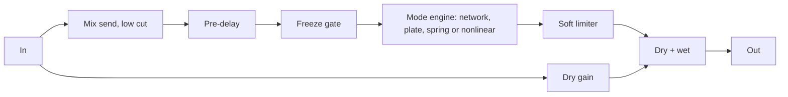

# Oxidal Bloom (LV2)

Oxidal's own reverb: eight voices behind one Mode control, original safe Rust ([REFERENCES.md](../crates/oxidal-bloom/REFERENCES.md)).

- **Plugins:** `urn:oxidal:plugin:bloom#mono`, `urn:oxidal:plugin:bloom#stereo`.
- **Bundle:** `oxidal-bloom.lv2`, one binary `oxidal_bloom.so`; shared control layout; latency 0.

## Controls

| Control          | Symbol     | Range       | Default   | What it does                                       |
| ---------------- | ---------- | ----------- | --------- | -------------------------------------------------- |
| Mode             | `mode`     | 0–7 (names) | Hall      | The voice                                          |
| Decay            | `decay`    | 0.1–60 s    | 2.5 s     | Time to fall 60 dB, log (Nonlinear: 0.1–1.2 s)     |
| Pre-delay        | `predelay` | 0–250 ms    | 10 ms     | Delay before the reverb                            |
| Size             | `size`     | 0–100%      | 50%       | Echo spacing (Nonlinear: echo blur)                |
| Tone             | `tone`     | 0–100%      | 60%       | Lower: highs die sooner; 100 no damping            |
| Low cut          | `lowcut`   | 20–1000 Hz  | 100 Hz    | Bass kept out of the reverb, log                   |
| Mod              | `mod`      | 0–100%      | 30%       | Tail modulation depth (not Nonlinear)              |
| Mod speed        | `speed`    | 0–100%      | 50%       | Half to twice the mode's modulation rate           |
| Shimmer          | `shimmer`  | 0–100%      | 50%       | Share of tail shifted per pass (Shimmer only)      |
| Shimmer interval | `interval` | 0–2 (names) | Octave up | Octave up, Fifth up, Octave down (Shimmer only)    |
| Shape            | `shape`    | 0–2 (names) | Gate      | Gate, Reverse, Swell (Nonlinear only)              |
| Build            | `build`    | 0.1–5 s     | 1 s       | Swell time, log (Bloom only)                       |
| Mix              | `mix`      | 0–100%      | 30%       | 0 dry, 100 reverb only; lowered, the tail rings on |
| Freeze           | `freeze`   | off / on    | off       | Holds the tail and closes the input                |

## Modes

| Mode      | Value | What you hear                      | Built from                                    |
| --------- | ----- | ---------------------------------- | --------------------------------------------- |
| Room      | 0     | Small room, clear early reflection | Network, short lines, six early taps a side   |
| Hall      | 1     | Large hall, even tail              | Network, long lines, gentle modulation        |
| Plate     | 2     | Dense, bright plate                | Figure-of-eight tank of all-passes and delays |
| Spring    | 3     | Drip and chirp of a spring         | Two loops, each 64 dispersive all-passes      |
| Cloud     | 4     | Huge, slow, blurred wash           | Network, long diffusers, deep slow modulation |
| Bloom     | 5     | Tail swelling after the note       | Network; input half feeds heard half slowly   |
| Shimmer   | 6     | Octave or fifth rising in the tail | Network with two pitch shifters in the loop   |
| Nonlinear | 7     | Gated, reversed or swelling burst  | One delay, 32 shaped taps a side              |

## Signal flow



## How it works

- Network modes: 8 prime-length delay lines, energy-keeping feedback matrix, per-line loss set from length and Decay.
- Tone is a per-line shelf; Size rescales lines by crossfade (40 ms).
- Bloom: energy seeps from the input half to the heard half at a rate set by Build.
- Shimmer: two delay-line pitch shifters in the loop, working below 6.5 kHz.
- Plate: Dattorro (1997). Spring: dispersive loops, Välimäki, Parker and Abel (2010).
- Mode change: network modes morph; to or from Plate, Spring or Nonlinear the old engine rings out under a 50 ms fade.
- Freeze: over about 100 ms loop gains go to one, modulation stops, input closes; loses under 1 dB per hour.
- Mix scales only the send, so the tail survives a dry scene; Mix 0 with no tail is bit-exact dry.

## Limits

- Bloom's swell cannot outlast the tail: a one-second swell needs Decay near 15 s or more.
- High Shimmer shortens long decays (about 5 s at 100%); the result is a flutter, not clean transposition.
- Spring models only below 4.0 kHz (3.7 kHz at 44.1 kHz), so it is darker than a real tank.
- A frozen tail does not move; Nonlinear Freeze repeats the last shape.
- An engine left by a Mode change rings out (at most 6 s), is not held by Freeze, and doubles cost.
- Full-band Decay at default Tone reads about a fifth short; the wet signal soft-limits 24 dB above full scale.

## Realtime

- All memory allocated at creation: about 1.2 MB at 48 kHz, 2.3 MB at 96 kHz.
- Processing only computes; idle engines sleep, silence in gives exact silence out.
- No panic path: masked or checked indexing, every control clamped.

## Build, test and qualify

```sh
cargo test -p oxidal-bloom
cargo test --release -p oxidal-bloom -- --ignored
cargo run --release -p oxidal-bloom --example bloom_bench
oxidal-plugin-check --bundle oxidal-bloom.lv2/ --sample-rate 48000 --frames 48
```

Tests cover every mode (silence, bounds, block-size independence, bit-exact dry at Mix 0), click-free control sweeps, stereo balance, Decay accuracy at 44.1, 48 and 96 kHz, Freeze stability, and the control table against `lv2/bloom.ttl`. The harness ([LV2 host](lv2.md#offline-pack-smoke-checks)) should report both plugins `usable` with `latency_frames` 0.
