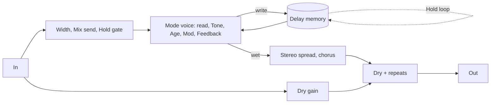

# Oxidal Echo (LV2)

Oxidal's own delay: eight echo kinds behind one Mode control, up to 4 s, tempo divisions and Hold. Safe Rust ([REFERENCES.md](../crates/oxidal-echo/REFERENCES.md)).

- **Plugins:** `urn:oxidal:plugin:echo#mono`, `urn:oxidal:plugin:echo#stereo`.
- **Bundle:** `oxidal-echo.lv2`, one binary `oxidal_echo.so`; 14 shared controls (ports 0–13); latency 0.

## Controls

| Control  | Symbol     | Range      | Default | What it does                                                         |
| -------- | ---------- | ---------- | ------- | -------------------------------------------------------------------- |
| Mode     | `mode`     | 8 choices  | Digital | The kind of echo                                                     |
| Time     | `time`     | 20 ms–4 s  | 380 ms  | Delay time, log (Sync off)                                           |
| Sync     | `sync`     | off, on    | off     | Time from BPM and Division                                           |
| BPM      | `bpm`      | 40–240     | 120     | Tempo for Sync; a plain control                                      |
| Division | `division` | 0–12       | 1/4     | 4 bars to 1/16 triplet (list shared with Motion); over 4 s plays 4 s |
| Feedback | `feedback` | 0–110%     | 35%     | Repeats recirculated; above 100 settles at a steady level            |
| Tone     | `tone`     | 0–100%     | 50%     | Repeat colour: dark to thin (Filter: sweep centre)                   |
| Mod      | `mod`      | 0–100%     | 20%     | Wow, drift, duck depth, sweep depth or chorus, by mode               |
| Age      | `age`      | 0–100%     | 30%     | Darker, saturated, more flutter (Tape, Heads); noise (Bucket)        |
| Heads    | `heads`    | 15 choices | All     | Which of four heads sound (Heads only)                               |
| Spacing  | `spacing`  | 0–100%     | 0%      | 0 even, 100 golden-ratio head spacing (Heads only)                   |
| Width    | `width`    | 0–100%     | 50%     | 0 mono repeats, 100 widest (stereo only)                             |
| Mix      | `mix`      | 0–100%     | 20%     | 0 dry, 50 equal, 100 repeats only; lowered, the tail rings on        |
| Hold     | `hold`     | off, on    | off     | Loops memory unchanged and closes input                              |

## Modes

| Mode    | Value | What you hear                                                         |
| ------- | ----- | --------------------------------------------------------------------- |
| Digital | 0     | Clean repeats; Tone cuts each one; time change crossfades             |
| Tape    | 1     | One head; time change glides pitch; wow, flutter, saturation with Age |
| Heads   | 2     | Four tape heads chosen by Heads, placed by Spacing                    |
| Bucket  | 3     | Bucket-brigade: longer time darker, companded, noise with Age         |
| Reverse | 4     | Each repeat plays backwards in windows of the delay time              |
| Duck    | 5     | Digital repeats that drop while you play and rise in the gaps         |
| Filter  | 6     | Resonant filter sweeps the repeats once every four repeats            |
| Ping    | 7     | Repeats alternate left and right (stereo); Digital in the mono plugin |

## Signal flow



## How it works

- One delay memory per channel; each mode reads it differently and writes finished audio, so Mode change (45 ms fade) keeps the tail and Hold works in any mode.
- Digital, Duck, Filter, Ping, Reverse: whole-sample reads, 30 ms crossfade on time change.
- Tape, Heads, Bucket: fractional reads glide pitch, at most one octave; Tape wow about 1 Hz, flutter about 9 Hz.
- Bucket: 4096-stage line clocked by Time, filters at a third of the clock (1.5 kHz from 455 ms), 2:1 compander.
- Reverse: windows played end to start, 20 ms crossfades; feedback runs forwards.
- Feedback bound: written audio never exceeds twice full scale; above −3 dBFS feedback is turned down smoothly.
- Stereo: separate memories; right repeats lag up to 12 ms, modulation out of step.
- Mix to 50 raises the send; 50 to 100 lowers dry; repeats are never lowered.

## Limits

- Tape has no hysteresis, bias or hiss; wow and flutter are generic.
- Bucket uses generic filters and a plain compander; clock stops falling at 455 ms.
- Large time jumps glide: about 4 s down, 8 s up.
- Reverse windows are at most about 2.7 s; longer Time still plays 2.7 s windows.
- Hold fixes loop length; Time then moves the listening point.
- Sync follows the BPM control, not a clock; Feedback above 100 settles near −3 dBFS.

## Realtime

- All memory allocated at creation: 2.1 MB stereo at 44.1 and 48 kHz, 4.2 MB at 88.2 and 96 kHz.
- Processing only computes; controls clamped, indexes masked.
- Updates every 16 samples: block size never changes the sound.

## Build, test and qualify

```sh
cargo test -p oxidal-echo
cargo test -p oxidal-echo --release -- --ignored   # the 60 s runs
cargo clippy -p oxidal-echo --all-targets -- -D warnings
cargo run --release -p oxidal-echo --example echo_bench
oxidal-plugin-check --bundle oxidal-echo.lv2/ --sample-rate 48000 --frames 48
```

Tests cover every mode (silence, bit-exact dry at Mix 0, bounded output at maximum feedback, block-size independence), click-free control and mode changes, Time and Division accuracy, per-mode behaviour, Hold and the control table against `lv2/echo.ttl`. The harness ([LV2 host](lv2.md#offline-pack-smoke-checks)) should report both plugins `usable` with `latency_frames` 0.
