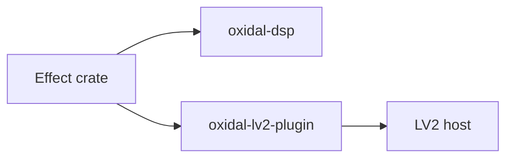

# Oxidal's own effects

Oxidal ships LV2 effects of its own, installed with the appliance; no effect pack needed. The first three are C++ under `native/`; the newer ones are Rust crates in this workspace.

| Effect         | Directory               | Page                                   |
| -------------- | ----------------------- | -------------------------------------- |
| Oxidal Hold    | `native/hold`           | [native-hold.md](native-hold.md)       |
| Oxidal Swell   | `native/swell`          | [native-swell.md](native-swell.md)     |
| Oxidal Pitch   | `native/pitch`          | [native-pitch.md](native-pitch.md)     |
| Oxidal Bloom   | `crates/oxidal-bloom`   | [native-bloom.md](native-bloom.md)     |
| Oxidal Sustain | `crates/oxidal-sustain` | [native-sustain.md](native-sustain.md) |
| Oxidal Echo    | `crates/oxidal-echo`    | [native-echo.md](native-echo.md)       |
| Oxidal Motion  | `crates/oxidal-motion`  | [native-motion.md](native-motion.md)   |

## Shared crates

- `crates/oxidal-dsp`: delay memory, parameter smoothing, filters, oscillator, limiter, noise and feedback mixers; safe Rust on the standard library alone.
- `crates/oxidal-lv2-plugin`: the LV2 interface. An effect implements its `Plugin` trait and calls `export!`. The C interface's raw pointers, and the only `unsafe` code, live here.

## Clean code rule

Oxidal's own effects are original code. Oxidal Pitch is the one exception: it builds a third-party pitch engine and says so in its NOTICE. For every other effect, in `native/` or in a crate:

**Allowed sources**

- Published papers, textbooks and standards that describe an algorithm in words and equations.
- Oxidal's own original code.
- The LV2 specification and headers, and the language's standard library.

**Not allowed**

- Proprietary material of any kind: firmware, disassembled or decompiled binaries, leaked source or schematics, service documents, presets or parameter tables from a commercial unit.
- Third-party source code as a base, whatever its licence: not copied, ported, translated to another language or paraphrased line by line.
- Constant tables taken from someone else's code. Values come from a cited paper or a derivation the references file shows.
- Recordings, impulse responses or captures of a commercial unit embedded as data, and fitting an effect to measurements of one specific unit.
- A third-party DSP library, or any crate from outside this workspace, as a dependency of an effect.
- Maker, product or artist names in code, comments, docs or preset text.
- A method known only from a patent, unless the project owner has decided it may be used.

**How it is kept**

- Each effect has a `NOTICE` stating "Original code" and "No third-party DSP", and a `REFERENCES.md` with one row per algorithm: its published source and how its constants were chosen.
- `scripts/test_effects_clean.py`, run by `pnpm check`, verifies those files, that the Rust effects depend on nothing outside this workspace, and that `unsafe` appears only in the plugin interface crate.

## Conventions for a new effect

- **Crate:** `crates/oxidal-<name>/`, built as a library for tests and as the plugin's shared object: `src/`, `lv2/manifest.ttl`, `lv2/<name>.ttl`, `NOTICE`, `REFERENCES.md`, `tests/`, `examples/<name>_bench.rs`.
- **Bundle:** `oxidal-<name>.lv2` with a mono and a stereo plugin, `urn:oxidal:plugin:<name>#mono` and `#stereo`, sharing one control layout. Ports numbered controls first, then audio inputs, then audio outputs.
- **Controls:** float control ports only, so scenes and MIDI can set every one. Choices are integer enumeration ports with named scale points.
- **Smoothing:** every continuous control is smoothed inside the effect; a mode change crossfades and does not cut a tail.
- **Mix:** scales what is sent into the effect, so a tail rings out when Mix is turned down.
- **Realtime:** no added latency; no allocation, lock, file or system call while audio runs. Memory sized at creation, for 44.1 to 96 kHz.
- **Safety:** safe Rust only; no code path that can panic while audio runs; output finite and bounded at every setting.
