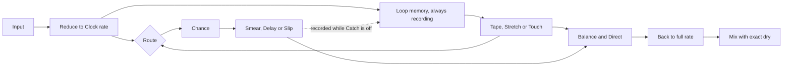

# Oxidal Moment (LV2)

Oxidal's own micro-looper and texture effect: it records all the time, so one switch keeps what you just played as a loop to slow down, turn round, stretch or smear. Safe Rust ([REFERENCES.md](../crates/oxidal-moment/REFERENCES.md)).

- **Plugins:** `urn:oxidal:plugin:moment#mono`, `urn:oxidal:plugin:moment#stereo`.
- **Bundle:** `oxidal-moment.lv2`, one binary `oxidal_moment.so`; shared layout, ports 0–23; latency 0.

Mixed-rig scene bypass keeps Moment processing. With Catch on, bypassing the block and recalling an active scene plays the caught phrase again, even after the live input falls silent.

The caught loop lives in memory only. It is not saved with a preset and is gone when the effect is removed or the unit restarts. For long recordings that are kept, use the looper.

## Controls

| Control   | Symbol     | Range                                            | Default        | What it does                                                                 |
| --------- | ---------- | ------------------------------------------------ | -------------- | ---------------------------------------------------------------------------- |
| Clock     | `clock`    | 0–100%                                           | 100%           | Working rate of the whole effect, full rate down to 1/16                     |
| Steps     | `steps`    | off, on                                          | on             | On: Clock moves in octaves and fifths. Off: smoothly                         |
| Grit      | `grit`     | 0–100%                                           | 0%             | 0 clean rate reduction, 100 stepped and aliased                              |
| Route     | `route`    | Input, Input and loop, Loop                      | Input and loop | What the wet half processes                                                  |
| Balance   | `balance`  | 0–100%                                           | 50%            | Loop against wet; both full at 50                                            |
| Catch     | `catch`    | off, on                                          | off            | On: the most recent audio plays as a loop. Off: back to recording            |
| Loop mode | `loopmode` | Tape, Stretch, Touch                             | Tape           | How the loop plays; changing it keeps the loop                               |
| Length    | `length`   | 0–100%                                           | 100%           | Tape: loop length, keeping the newest audio. Stretch, Touch: slice size      |
| Move      | `move`     | 0–100%                                           | 71%            | Tape: speed and direction. Stretch: drift. Touch: sensitivity                |
| Overdub   | `overdub`  | off, on                                          | off            | Adds the clean input to the loop                                             |
| Fade      | `fade`     | 0–100%                                           | 100%           | Share of the loop kept on each pass while overdubbing                        |
| Direct    | `direct`   | 0–100%                                           | 0%             | Unprocessed loop kept when the loop goes through the wet half                |
| Wet on    | `wet`      | off, on                                          | on             | Wet half on; off closes its input and lets the tail ring                     |
| Wet mode  | `wetmode`  | Smear, Delay, Slip                               | Smear          | The live effect                                                              |
| Time      | `time`     | 0–100%                                           | 50%            | Smear: size and decay, 50–600 ms. Delay: 20 ms–2 s. Slip: sample, 30 ms–1 s  |
| Shape     | `shape`    | 0–100%                                           | 50%            | Smear: echoes to wash. Delay: feedback. Slip: speed and direction            |
| Tone      | `tone`     | 0–100%                                           | 70%            | High cut on the wet half, 300 Hz to 20 kHz                                   |
| Chance    | `chance`   | 0–100%                                           | 100%           | Share of Time periods in which sound may enter the wet half                  |
| Freeze    | `freeze`   | off, on                                          | off            | Holds the wet sound and closes its input                                     |
| Link      | `link`     | Off, Loop follows Time, Time follows loop, Tempo | Off            | How the loop length and Time relate                                          |
| BPM       | `bpm`      | 40–240                                           | 120            | Tempo for Link Tempo; a plain control                                        |
| Division  | `division` | 0–12                                             | 1 bar          | Loop length for Link Tempo (list shared with Echo and Motion)                |
| Width     | `width`    | 0–100%                                           | 0%             | 0 keeps the incoming stereo picture; higher adds each mode's movement        |
| Mix       | `mix`      | 0–100%                                           | 50%            | 0 dry, 50 both full, 100 effect only; lowered, tails and a caught loop go on |

Move in Tape has eight steps: backwards at 4×, 2×, 1× and ½×, then forwards at ½×, 1×, 2× and 4×. In Stretch, the middle stops on one slice and both ends play at normal speed.

Slip's Shape moves in semitones: from the middle upwards plays forwards at unison to an octave up; below the middle plays backwards over the same range.

## Signal flow



- **Memory:** 4 s of loop at the full rate, so 64 s at the lowest Clock. Everything is counted in engine steps, so times, loop lengths and fades stretch as Clock falls, and a playing loop drops in pitch.
- **Recording:** while Catch is off, the input and the wet half's output are recorded, so a loop can hold its reverb. Overdub adds only the clean input.
- **Catch:** the loop is the most recent audio, as long as has been recorded since the effect started, up to the memory. A new catch waits for the old loop to finish fading.
- **Mix 0** is the exact dry signal while nothing is caught. A caught loop keeps playing at any Mix; a scene that wants silence switches Catch off.

## Scenes

Every control can be set by a scene. A scene with Catch on keeps the loop that is already playing, so a first scene can listen, a second can catch, and later ones can reshape the same loop. Continuous controls glide; a mode change crossfades and lets the old tail ring out.

## Sound to try

**Caught Moments** (OX-43, [Oxidal sounds](factory-collection.md)) walks through the effect in eight scenes on one caught loop: play a phrase in Listen, then step through Catch, Lead, Worn Half Speed, Backwards, Stretch, Touch and Frozen Octave. Return to Listen to let go of the loop.

## Limits

- The loop is not synchronised to the backing player or to MIDI clock. Link Tempo makes it an exact length at a BPM you set.
- Below the full Clock the rate-reduction filters add a short delay to the effect path only. The dry path stays exact.
- Stereo memory per instance is about 4.2 MB at 48 kHz and 8.4 MB at 96 kHz.

## Build and test

```bash
cargo test -p oxidal-moment
```

```bash
cargo clippy -p oxidal-moment --all-targets -- -D warnings
```

```bash
cargo run --release -p oxidal-moment --example moment_bench
```

```bash
oxidal-plugin-check --bundle oxidal-moment.lv2/ --sample-rate 48000 --frames 48
```

Tests cover Catch and the loop join, every Tape speed, Clock pitch and clicks, Grit, Stretch, Touch, Overdub and Fade, mode changes, each wet mode, Freeze, Chance, recording of the wet half, Route, Direct, Link, stereo Width, bounded output at every extreme, exact dry at Mix 0, block-size independence and the control table against `lv2/moment.ttl`.
