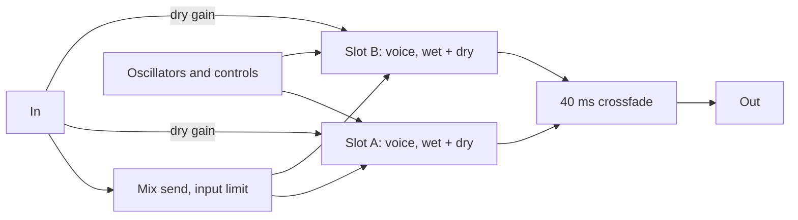

# Oxidal Motion (LV2)

Oxidal's own modulation effect: nine effects behind one Mode control and one set of knobs. Safe Rust ([REFERENCES.md](../crates/oxidal-motion/REFERENCES.md)).

- **Plugins:** `urn:oxidal:plugin:motion#mono`, `urn:oxidal:plugin:motion#stereo`.
- **Bundle:** `oxidal-motion.lv2`, one binary `oxidal_motion.so`; shared layout, ports 0–11; latency 0.

## Controls

| Control  | Symbol     | Range            | Default | What it does                                     |
| -------- | ---------- | ---------------- | ------- | ------------------------------------------------ |
| Mode     | `mode`     | 0–8 (see Modes)  | Chorus  | Picks the effect; 40 ms crossfade                |
| Rate     | `rate`     | 0.05–12 Hz       | 0.8 Hz  | Speed, log (Ring: carrier 20 Hz–2 kHz)           |
| Sync     | `sync`     | off/on           | off     | Speed from Tempo and Division (not Ring)         |
| Tempo    | `bpm`      | 40–240 BPM       | 120     | Tempo for Sync; a plain control                  |
| Division | `division` | 0–11 (see below) | 1/4     | Length of one sweep with Sync                    |
| Depth    | `depth`    | 0–100%           | 50%     | How far the effect moves (see Depth)             |
| Feedback | `feedback` | −100…100%        | 0%      | Ringing; negative hollow (Flanger, Phaser, Vibe) |
| Tone     | `tone`     | 0–100%           | 50%     | Brightness or position (not Tremolo)             |
| Shape    | `shape`    | A, B, C (0–2)    | A       | Variant per mode                                 |
| Stereo   | `stereo`   | 0–180°           | 90°     | Right lead over left (stereo only)               |
| Fast     | `fast`     | off/on           | off     | Slow/fast rotors (Rotary only)                   |
| Mix      | `mix`      | 0–100%           | 50%     | 0 is bit-exact dry                               |

Division: 4 bar, 2 bar, 1 bar, 1/2, 1/4 dotted, 1/4, 1/8 dotted, 1/4 triplet, 1/8, 1/8 triplet, 1/16, 1/16 triplet.

## Modes

| Mode     | Value | What it is                            | Shape A / B / C                             | Tone                      | Depth 100                            |
| -------- | ----- | ------------------------------------- | ------------------------------------------- | ------------------------- | ------------------------------------ |
| Chorus   | 0     | Detuned copies                        | Two voices / ensemble / shimmering ensemble | Copies, 3–20 kHz          | 4 ms sweep, up to 43 cents           |
| Flanger  | 1     | Short moving delay: comb sweep        | Classic / through-zero / inverted           | Delay brightness          | Fixed 1.7 ms comb to 0.3–10 ms sweep |
| Phaser   | 2     | Swept all-pass stages: moving notches | Four / six / eight stages                   | Sweep centre, 300–1500 Hz | Two octaves each way                 |
| Vibe     | 3     | Lamp-and-photocell phase stages       | Lamp / heavy lamp / even                    | Sweep centre, 120–720 Hz  | 20:1 sweep                           |
| Rotary   | 4     | Rotating horn and drum                | Both / horn only / brake                    | Horn brightness           | 50 natural; 100 doubles swing        |
| Tremolo  | 5     | Volume moved up and down              | Sine / triangle / rounded square            | —                         | Silence at cycle bottom              |
| Harmonic | 6     | Lows and highs swell alternately      | Sine / triangle / rounded square            | Split, 250–2000 Hz        | Lows and highs fully swapped         |
| Vibrato  | 7     | Pitch moved up and down, no dry       | Sine / triangle / drifting sine             | Brightness                | 60 cents each way                    |
| Ring     | 8     | Signal times a tone                   | Sine / square / octave-up                   | Brightness                | 0 plain, 100 ring only               |

## Signal flow



## How it works

- One oscillator for all modes: Mode changes keep the pulse; rate glides in 60 ms.
- Slow values update every 16 samples; controls smoothed 30 ms.
- Cubic delay interpolation; feedback loops have a 20 Hz high-pass and soft limiter.
- Mode or Shape change: second slot starts empty, input opens over 5 ms, 40 ms raised-cosine crossfade.
- Mix: Chorus, Flanger A, Phaser, Vibe blend; other modes fully on from 50 up.
- Vibe: lamp lag (rises faster than it falls) and steep photocell conductance.
- Rotary: drum at 86% of horn; Fast aims at 8x (max 16 turns/s); horn lags about 1 s, drum 3.5–4.5 s.

## Limits

- Models from published descriptions: ideal vibe all-passes, no rotary cabinet resonance or overdrive, no chorus noise.
- Ring is not a frequency shifter; square shapes and Ring B, C are not band-limited.
- Through-zero flanger delays its effect copy by 2.5 ms.
- Sync follows Tempo, not a clock.
- A parked rotor colours level by up to about 3 dB.

## Realtime

- No lookahead or latency.
- Memory (about 130 kB at 96 kHz) allocated at creation; processing only computes.
- No panic path: any control, sample or block length accepted.

## Build, test and qualify

```sh
cargo test -p oxidal-motion
cargo clippy -p oxidal-motion --all-targets -- -D warnings
cargo build --release -p oxidal-motion
cargo run --release -p oxidal-motion --example motion_bench
oxidal-plugin-check --bundle oxidal-motion.lv2/ --sample-rate 48000 --frames 48
```

Tests cover every mode and shape (silence, bounds, block-size independence, bit-exact dry, click-free changes), per-mode timing figures and the control table against `lv2/motion.ttl`. The harness ([LV2 host](lv2.md#offline-pack-smoke-checks)) should report both plugins `usable` with `latency_frames` 0.
