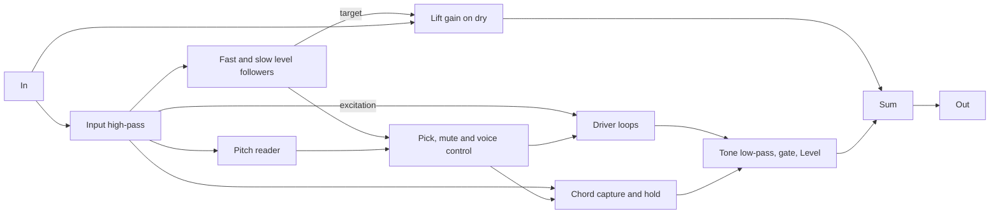

# Oxidal Sustain (LV2)

Oxidal's own sustainer: with On, each single note holds a steady level until you mute or play the next; a chord is held whole. Safe Rust ([REFERENCES.md](../crates/oxidal-sustain/REFERENCES.md)).

- **Plugins:** `urn:oxidal:plugin:sustain#mono`, `urn:oxidal:plugin:sustain#stereo`.
- **Bundle:** `oxidal-sustain.lv2`, one binary `oxidal_sustain.so`; latency 0. Place before drive and amp blocks.
- **Stereo:** listens to the input sum, keeps dry in stereo, adds the same note to both sides.

## Controls

| Control     | Symbol        | Range                                 | Default | What it does                                              |
| ----------- | ------------- | ------------------------------------- | ------- | --------------------------------------------------------- |
| On          | `on`          | off / on                              | on      | Off is exact pass-through; 30 ms fade                     |
| Mode        | `mode`        | Normal, Harmonic, Mix                 | Normal  | What the note settles on; 40 ms crossover                 |
| Harmonic    | `harmonic`    | Octave, Octave and fifth, Two octaves | Octave  | Harmonic for Harmonic and Mix                             |
| Drive       | `drive`       | 0–100%                                | 65%     | Held level (−9 dB at 0, equal at 100) and fill-in speed   |
| Bloom       | `bloom`       | 100 ms–10 s                           | 2 s     | Time to reach the harmonic, log (Mix only)                |
| Sensitivity | `sensitivity` | 0–100%                                | 50%     | How readily a mute or pick is recognised (see below)      |
| Tone        | `tone`        | 0–100%                                | 60%     | Low-pass 400 Hz–8 kHz (2.4 kHz at 60)                     |
| Level       | `level`       | −24…+6 dB                             | 0 dB    | Volume of everything added                                |
| Dry         | `dry`         | off / on                              | on      | Off: only the sustained note, swelling in after each pick |

## Modes

| Mode     | What it does                                                         |
| -------- | -------------------------------------------------------------------- |
| Normal   | Sustains the note at its own pitch                                   |
| Harmonic | Sustains the chosen harmonic; above 4.2 kHz a lower one is used      |
| Mix      | Starts as Normal, blooms into the harmonic over Bloom, like feedback |

Sensitivity thresholds (a slower level fall than the mute figure is a natural decay and is sustained):

| Sensitivity | Pick reaches | Pick jumps above ringing | Mute: fall faster than |
| ----------- | ------------ | ------------------------ | ---------------------- |
| 0           | −30 dBFS     | 12 dB                    | 130 dB/s               |
| 50          | −45 dBFS     | 7.5 dB                   | 53 dB/s                |
| 100         | −60 dBFS     | 3 dB                     | 27 dB/s                |

## Signal flow



## How it works

- Pitch: cumulative mean normalised difference on an 8 kHz copy, a reading every 10 ms; three agreeing readings confirm a note.
- Pitch tracking continues at low level (own AGC up to +60 dB), so bends and vibrato are followed while the string rings, about 30–45 ms behind.
- Octave-class jumps must persist 150 ms; the last pitch is held only when the string is lost in noise (300 ms without a reading 13 dB above noise).
- Lift: slow gain, at most 12 dB (Drive 0) to 3 dB (Drive 100), fading near the noise floor.
- Driver: period-long feedback delay line fed by the string; loop gain tops up to the held level; length follows each reading.
- Harmonic loop is tuned to the chosen harmonic and follows the bend in proportion, so the harmonic follows the bend.
- Chord hold: no pitch about 200 ms after a pick triggers 170 ms spectrum capture, up to 32 partials played as steady sinusoids.
- New pick fades the old voice in 40 ms; mute fades in 80 ms; Mode and Harmonic do not affect a held chord.

## Limits

- Follows the fretting hand only while the string moves.
- A dead string's mute is inaudible; a slow volume fade is held.
- One note at a time: chord hold is a snapshot, starts about 250 ms after the strum, does not follow bends.
- Notes under about 70 ms end before pitch is known; the Driver stays out.
- A held note is steadier than a real string; high notes near-pure within 10 s.
- Weak fundamentals may read an octave high; loud steady noise is sustained.

## Realtime

- Memory 0.3 MB at 48 kHz, 0.5 MB at 96 kHz, allocated at creation; no `unsafe`, no panic path.
- Dry never delayed; analysis spread across samples (chord passes every 64).
- Decisions tied to sample count: block size never changes output.

## Build, test and qualify

```sh
cargo test -p oxidal-sustain
cargo clippy -p oxidal-sustain --all-targets -- -D warnings
cargo run --release -p oxidal-sustain --example sustain_bench
oxidal-plugin-check --bundle oxidal-sustain.lv2/ --sample-rate 48000 --frames 48
```

Tests use synthetic plucked strings to check hold level and pitch for a minute, bend following, mutes, new notes, harmonics, chords, Off bit-exactness, the shared effect rules and the control table against `lv2/sustain.ttl`. The harness ([LV2 host](lv2.md#offline-pack-smoke-checks)) should report both plugins `usable` with `latency_frames` 0. See also [Oxidal's own effects](native-effects.md).
