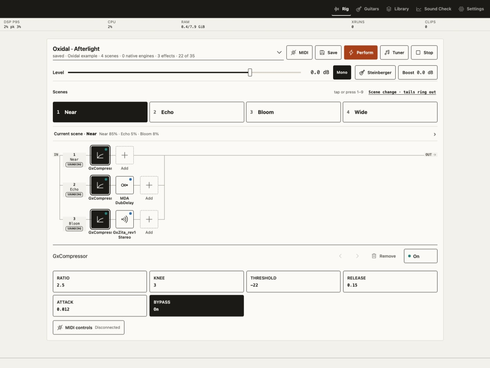
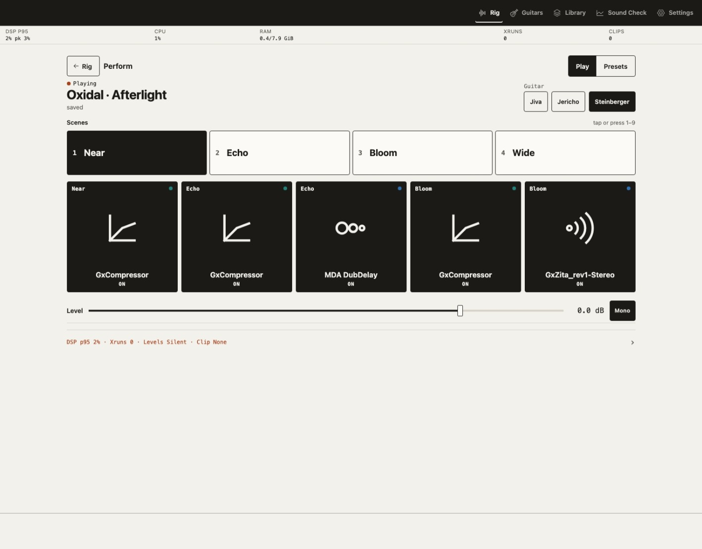
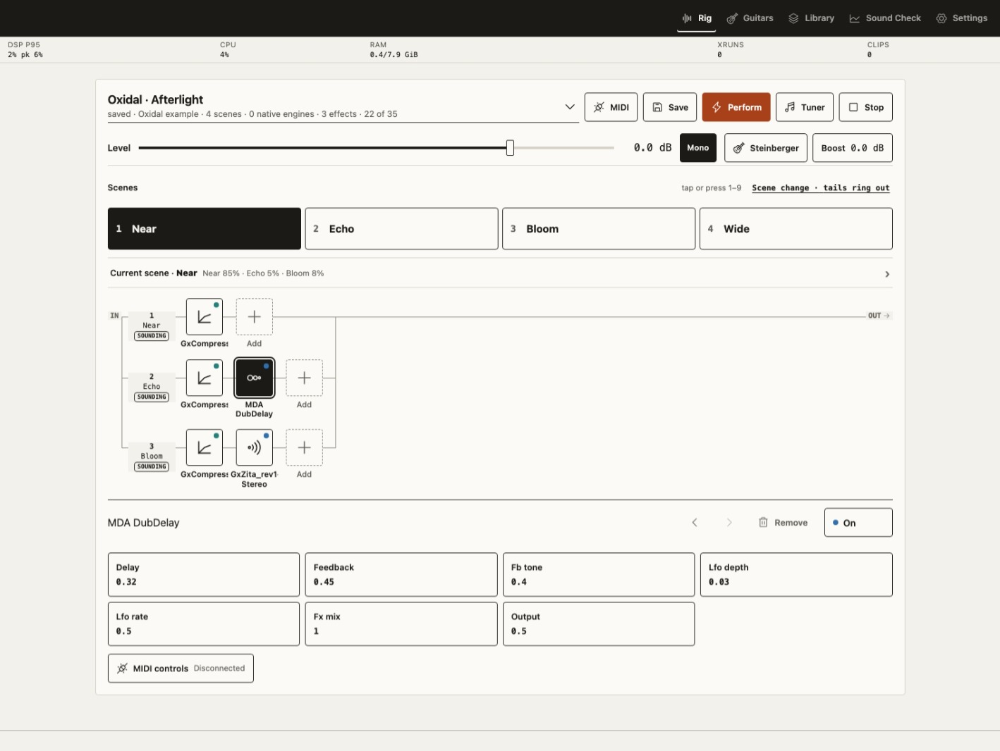
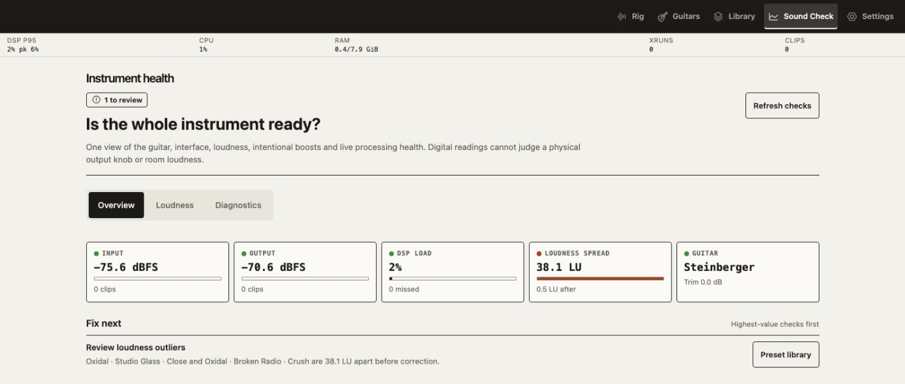

# Screenshots

These screenshots show Oxidal running on a Raspberry Pi appliance with live audio.
The selected **Oxidal · Afterlight** example uses only installed LV2 effects; it has
no bundled capture, model or impulse-response payload.

The [full README gallery](../README.md#screenshot-gallery) also shows audio
setup, the running engine, network, accounts, MIDI, effects, display, device
settings, maintenance, and live diagnostics.

## Rig

## Perform

## Effect controls

## Sound Check

